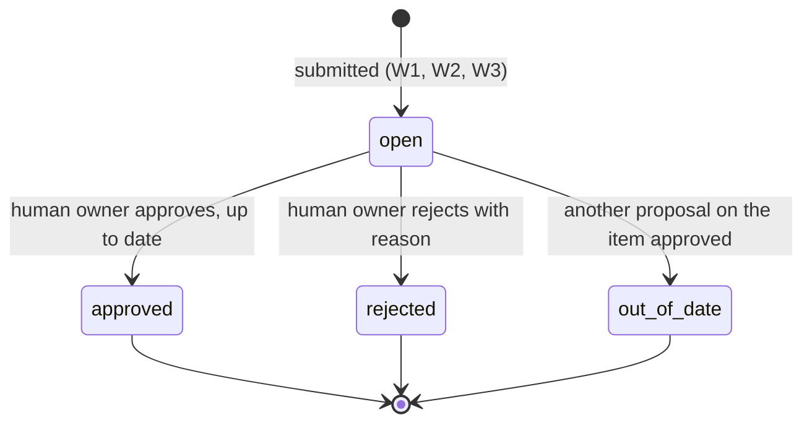
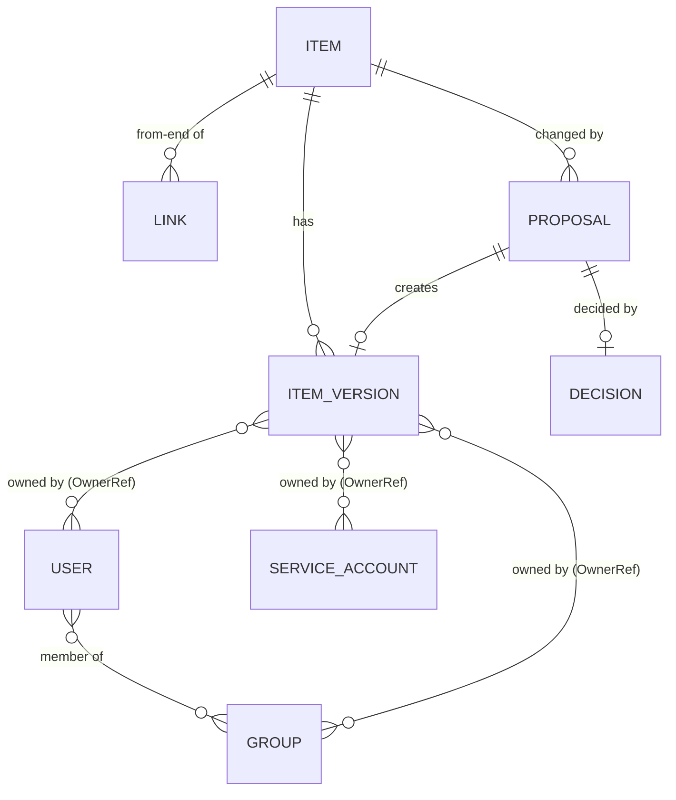

# Functional Spec — U1 walking skeleton

U1 is the thin end-to-end slice (`inception/units-generation/unit-of-work.md`): knowledge goes in, is approved, is stored with its history, and is read back by a person on a basic web page and by an AI agent through MCP, all from containers. It delivers thin versions of four stories from `inception/user-stories/stories.md`: create an item (US2.1), decide on a proposal (US2.4), read an item (US3.5) and an AI agent reads organisational context (US4.1). Later units finish them (U3, U6, U14, U15, U18, U19).

This file is the source of truth for the workflows and the proposal lifecycle. The data shape is in `entities.md` and the decision logic in `rules.md`; the diagram and table at the end are views derived from those two files.

## Seeded actors

| Actor | Kind | Role | Purpose |
|---|---|---|---|
| Contributor | User | Contributor | Proposes items and changes |
| Owner | User | Contributor | Owns items and decides on proposals; member of the seeded group |
| Owners group | Group | (permissions come in U2) | Proves group ownership end to end |
| Agent | ServiceAccount | Contributor | Reads, searches and proposes through MCP |

The seeded accounts are configuration, not real organisation content, and their secrets come from the environment, never the repository (project rule).

## Workflows

### W1 Create an item (US2.1)
1. A person opens the basic item page and chooses "new item".
2. They enter title, type (from the seven), content, why, owners (people, groups or agents), any manual sources, any links to existing items, and a reason for the change.
3. They submit. The system checks BR1.2 to BR1.5. If anything is missing or wrong, it names each problem and returns the form with their text kept; nothing is saved (AC2.1.2).
4. The system records a `create` Proposal (status open, origin person) with a reserved item identifier. No Item exists until the proposal is approved, so nothing appears in reads or search yet (BR1.1, AC2.1.1). Links in a create proposal may only point at approved items (BR1.5).
5. The proposal appears to every human owner of the proposed item.

### W2 Change an item, or add or remove a link
1. From an approved item's page, a person chooses "propose change" (fields, owners, sources) or "add link" / "remove link".
2. They submit with a reason. The system checks BR1.2 to BR1.6 and records the Proposal with `baseVersionId` set to the item's current version. A link change is a change to its from-item; both ends must be approved items (BR1.5). The new version copies everything the proposal does not change (BR3.3).
3. Every proposal, from the web page or MCP, carries an idempotency key; a repeat with the same key returns the first proposal (BR1.7).
4. Other open proposals on the same item are unaffected until one is approved (W4 step 5).

### W3 An AI agent proposes through MCP
1. The agent calls `propose_change` with its service-account token and an idempotency key.
2. The system checks the account is active and has the Contributor role (BR5.1), then applies W1 or W2 checks.
3. The proposal is recorded with origin `ai-agent`; a repeated call with the same key returns the same proposal.
4. Nothing changes until a human owner approves it (BR1.1).

### W4 Decide on a proposal (US2.4)
1. A human owner opens the open proposal and sees the proposed change beside the current version.
2. They choose approve (with an optional comment) or reject (with a required reason).
3. The system checks, in order: caller is not an agent (BR2.2); caller is a human owner (BR2.1, AC2.4.3, AC2.4.4); proposal is open (BR2.6); for approve, the proposal is up to date (BR2.7); for reject, a reason is given (BR2.5, AC2.4.2). A failed check refuses the decision and leaves the proposal unchanged.
4. **Reject:** record the Decision; set the proposal to `rejected`. The item is unchanged; the reason stays in history. A rejected create proposal leaves no item (BR1.8).
5. **Approve:** in one all-or-nothing step, record the Decision (flagged `isSelfApproval` when the decider proposed it, BR2.4); for a create, create the Item with the reserved identifier; create the next ItemVersion, copying unchanged fields from the base version and adding this version's system source (BR1.6, BR3.1, BR3.3); apply any link change, recording this version as the one that added or removed it; point the item at the new version and set `lastReviewedAt`; set the proposal to `approved`; set every other open proposal on the item whose base version is now old to `out-of-date` (BR2.7). If any part fails, nothing is applied and the proposal stays open.

### W5 Read an item on the basic page (US3.5)
1. A signed-in person opens an item.
2. The page shows the approved version: title, type, content, why, owners (people, groups, agents), links in both directions with their type, sources, and the last-reviewed date (AC3.5.1).
3. It shows the full history: each version with proposer, decider, time, reason, and a "self-approved" mark where it applies; plus rejected and out-of-date proposals with their reasons.
4. If proposals are open, it lists them separately, marked "not yet approved" (BR4.1).
5. An open create proposal is not an item yet: it appears only to its proposer and to the human owners named in it, as a pending proposal (BR1.8).

### W6 An AI agent reads and searches through MCP (US4.1)
1. The agent calls `search_knowledge` with text. The system returns approved items whose title or content match, each with type, owners, sources and last-reviewed date (BR4.2, AC4.1.1).
2. The agent calls `get_item`. The system returns the approved version with links, owners and sources, and lists open proposals separately as not yet approved (BR4.1, AC4.1.2).
3. A deactivated or unknown token is refused.

### W7 End-to-end check (the skeleton's proof)
1. Start the containers.
2. The contributor creates an item owned by the seeded group (W1).
3. The owner approves it (W4).
4. The item appears on the basic page with its history (W5) and through MCP search and read (W6).
5. The agent proposes a change through MCP (W3); the owner approves; the new version and its "AI agent" origin show in the page history and through MCP.

## Proposal lifecycle

<!-- Text fallback: A proposal starts open. From open it becomes approved (a human owner approves and it is up to date), rejected (a human owner rejects with a reason), or out_of_date (another proposal on the same item was approved first). All three are final. Request changes and withdraw come in U6. -->

| From | To | When | Rule |
|---|---|---|---|
| (none) | open | proposal submitted and valid | BR1.1 to BR1.5, BR5.1 |
| open | approved | a human owner approves an up-to-date proposal | BR2.1 to BR2.4, BR3.1 |
| open | rejected | a human owner rejects with a reason | BR2.1, BR2.2, BR2.5 |
| open | out-of-date | another proposal on the same item is approved | BR2.7 |

**Item lifecycle:** an Item is created `active` when its create proposal is approved; a rejected or out-of-date create proposal leaves no item (BR1.8). Archive comes in U6.

## Errors and edge cases

| Case | Behaviour |
|---|---|
| Two owners decide the same proposal at once | The first decision wins; the second is refused as already decided (BR2.6) |
| Two proposals on one item, both approved at once | The first applies; the second is refused as out of date (BR2.7) |
| A proposal names a deactivated person or an unknown group as owner | Refused, naming the entry (BR1.4) |
| An owner group loses all members later | Its items keep the group as owner; deciding needs another human owner; handled fully in U2 and U6 |
| Storage fails during an approval | Nothing is applied; the proposal stays open and the person is told to try again (BR3.1, NFR10) |
| A person or agent retries a proposal after a timeout | The same idempotency key returns the original proposal; the same key with a different request is refused (BR1.7) |
| A proposal links to an item that is not approved yet | Refused; both ends must be approved items (BR1.5) |
| A link proposal touches an item owned by someone else | The from-item's human owners decide in U1; whether the to-item's owners must also approve is decided in U6 |

## Derived views

### Entity relationships (from `entities.md`)

<!-- Text fallback: An Item has many ItemVersions, is the from-end of many Links and is changed by many Proposals. A Proposal has at most one Decision and creates at most one ItemVersion. Users belong to Groups. Each ItemVersion is owned, through OwnerRef entries, by Users, Groups and ServiceAccounts. -->

### Rules summary (from `rules.md`)

| Area | Rules |
|---|---|
| Proposing | BR1.1 to BR1.8, BR5.1 |
| Deciding | BR2.1 to BR2.7 |
| History | BR3.1 to BR3.3 |
| Reading | BR4.1, BR4.2 |

## What U1 leaves to later units

| Left out | Unit |
|---|---|
| Real sign-in, roles and the group permission matrix | U2 |
| Organisation-defined types, type fields, contexts, "applies to", archive | U3, U6 |
| Request changes, withdraw, unowned items, Approver and Admin routes | U6 |
| Impact assessment and conflict blocking at creation | U5, U6 |
| Restricted sources, connected-tool sources | U8, U9, U18 |
| Item-level access for agents, answers with citations | U14, U15 |
| Final screens | U18, U19 |

## Sources
- `inception/units-generation/unit-of-work.md` (U1 boundary and end-to-end check).
- `inception/user-stories/stories.md` (US2.1, US2.4, US3.5, US4.1).
- `inception/contract-design/contract-summary.md` (C1 idempotency, C2 MCP tools).
- `entities.md`, `rules.md`, `functional-design-questions.md` Q1 to Q11.
