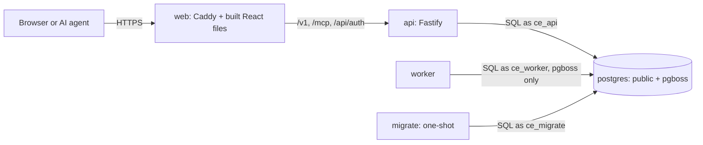

# Logical Components — U1 walking skeleton

Where the NFR designs apply, for Infrastructure Design to place. Containers follow `inception/contract-design/contract-summary.md`; the stack is `../nfr-requirements/tech-stack-decisions.md`.

<!-- Text fallback: Browsers and AI agents reach the web container (Caddy, which also serves the built React files) over HTTPS. Caddy forwards /v1, /mcp and /api/auth to the api container (Fastify). The api uses PostgreSQL as ce_api. The worker uses only the pgboss schema as ce_worker. A one-shot migrate container runs migrations and the seed as ce_migrate. -->

## Components

| Component | Contains | Exposed | NFR designs applied |
|---|---|---|---|
| `web` (Caddy) | TLS, security headers, routing, static web files | 80, 443 to the host | security (transport, headers, routing) |
| `api` | Auth hook, Origin check, schema validation, proposal and knowledge modules, MCP server, `JobQueue.enqueue`, metrics | 3000 on the private network | security, reliability (transaction, idempotency), performance, observability |
| `worker` | pg-boss runner behind `JobQueue`; no job types in U1 | 3001 (health, metrics) on the private network | reliability (retry, dead letter), scalability (leases), observability |
| `postgres` | Knowledge tables, Better Auth tables, `pgboss` schema; volume `pgdata` | 5432 on the private network | security (roles and grants), reliability (durability) |
| `migrate` | Kysely and pg-boss migrations, role grants, seed; exits when done | none | security (separate owner role, hashed seed secrets) |

## Failure domains

| Failure | Effect | Contained by |
|---|---|---|
| `api` stops | Web and MCP unavailable; no partial approval | Transaction rollback; Compose restart |
| `worker` stops | Jobs wait in the queue (none in U1) | Queue in PostgreSQL; restart |
| `postgres` stops | Everything unready; `/readyz` 503 | Volume keeps data; restart |
| `migrate` fails | `api` and `worker` do not start | Compose `depends_on: service_completed_successfully` |
| `web` stops | No access from outside | Restart |

## Build, test and run (NFR11.1 to NFR11.3, NFR12.1)

| Requirement | Design |
|---|---|
| NFR11.1 tests first | Each pull request's commits show the failing test before the code; reviewers check it (team review practice) |
| NFR11.2 80% coverage | Vitest with V8 coverage per package (`api`, `worker`, `web`), `thresholds.lines: 80`; below it the test job fails |
| NFR11.3 CI gate | One GitHub Actions workflow on every pull request: install, Prettier check, ESLint, `tsc --noEmit`, Vitest with coverage, secret scan, then the Compose end-to-end check (W7). Rust jobs (`cargo fmt --check`, `clippy -D warnings`, `cargo test`) run only when a `Cargo.toml` exists. Branch protection on `main` requires the workflow to pass |
| NFR12.1 containers only | Each part has a Dockerfile built on public base images; `docker compose up` with a filled `.env` is the only setup; nothing calls a cloud provider's API |

Integration tests run against a real PostgreSQL in a container (Compose service in CI), not a mock, because the grants, locks and pg-boss behaviour are what they prove.

## Coverage limits (U1 covers part of these requirements)

| Requirement | U1 delivers | Rest closed by |
|---|---|---|
| NFR2 answer speed | Latency measured (NFR2.1) | U15, U16 |
| NFR4 sizing | Stateless shape, two-copy test | U20 load check |
| NFR6 privacy | No content in logs, errors, jobs | U8 (Admin-only raw source content) |
| NFR13 observability | Health, logs, metrics | U8 (sync status per connection) |

## Sources
- `../nfr-requirements/tech-stack-decisions.md`, `../nfr-requirements/security-requirements.md`, `../nfr-requirements/reliability-requirements.md`, `../nfr-requirements/scalability-requirements.md`, `../nfr-requirements/performance-requirements.md`, `../nfr-requirements/observability-requirements.md`.
- `../functional-design/functional-spec.md` (W7).
- `inception/contract-design/contract-summary.md` (containers, C3, C8).
- Requirements review finding R-03 (partial coverage).
