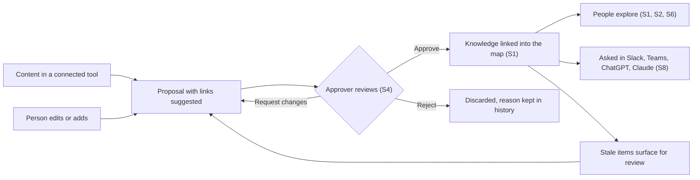

# User Flows: Organisational Context Engine

Inputs: `ideation/intent-capture/intent-statement.md` (intent-statement), `ideation/scope-definition/scope-document.md` (scope-document), `ideation/scope-definition/intent-backlog.md` (intent-backlog), and `rough-mockups-questions.md`. Screen IDs refer to `wireframes.md`.

## Core flow: knowledge enters, gets linked and is used

<!-- Text fallback: Content from a connected tool, or a person's edit, becomes a proposal with suggested links. An approver reviews it in S4: approve links it into the map; request changes returns it to the proposal; reject discards it but keeps the reason in history. Approved knowledge is explored in the map, detail and list views, asked about from chat tools and AI assistants, and stale items come back as new proposals. -->

Most important to get right: the links. Each approved item links to its process, team, owner, systems and decision. (Q2, Q7)

## Flow 1: Explore how knowledge is linked

- **Persona:** business person or leader (intent-statement)
- **Trigger:** opens the web app
- **Steps:**
  1. S1 Map: types "discount" in search. The map flies to the matching nodes, and the side panel lists them.
  2. S1: filters by Team = Finance. Other nodes fade, and the list narrows.
  3. S1: clicks the "Discount limit" node. The side panel shows its links.
  4. S2 Node detail: reads the rule, why it exists, and its sources. Clicks Summarise to get an AI summary of its life.
- **Success:** the person sees the rule, who owns it, why it exists and what it touches.
- **Error paths:**
  - No match. The panel says "No matches for 'discount'. Try another word or ask the question instead."
  - The map fails to load. The page offers the list view (S6).

## Flow 2: Approve a captured change

- **Persona:** approver (intent-statement)
- **Trigger:** a proposal arrives, extracted from Slack or another connected tool (scope-document)
- **Steps:**
  1. S4 Reviews: opens the proposal and sees before and after, the source excerpt, and what else it affects.
  2. Checks the suggested links and adjusts them.
  3. Approves it. The item appears in the map, and its history records who approved it, when, and why.
- **Success:** the change is live, and its history is complete.
- **Error paths:**
  - The source is no longer reachable. The proposal shows the saved excerpt with a note.
  - The proposal conflicts with a change approved in the meantime. The approver sees both versions and picks one.

## Flow 3: Ask from an existing tool

- **Persona:** anyone, or an AI agent (intent-statement)
- **Trigger:** asks a question in Slack or Teams, or ChatGPT or Claude asks through MCP
- **Steps:**
  1. S8: the question goes to the engine.
  2. The answer comes back with its source and its approval status.
  3. "Open in map" jumps to S2.
- **Success:** the person gets an answer grounded in approved knowledge.
- **Error paths:**
  - Nothing approved matches. The assistant says so, and offers to raise it as a gap for an owner.
  - The source is stale. The answer is labelled with when it was last reviewed.

## Flow 4: Simulate before proposing

- **Persona:** rule owner (intent-statement)
- **Trigger:** clicks Simulate on a node (S2)
- **Steps:**
  1. S5: edits the rule in the sandbox and sees the affected processes, systems and decisions.
  2. Runs an AI scenario to see how a process would play out.
  3. Clicks "Turn this into a proposal". This goes to S4 for approval.
- **Success:** the change is proposed with its impact already known. (Q9)
- **Error path:** the scenario fails. The panel says so, and the sandbox edit is kept.

## Flow 5: See what changed

- **Persona:** anyone
- **Trigger:** clicks History on a node (S2)
- **Steps:**
  1. S3: reads the timeline of plain-language changes.
  2. Opens before and after for one change.
- **Success:** the person knows who changed what, when and why. (Q3; intent-statement)

## Assumptions & Open Questions

- [assumption] The conflict handling in Flow 2 (pick one of two versions) is a first sketch; the real rule is set in requirements.
