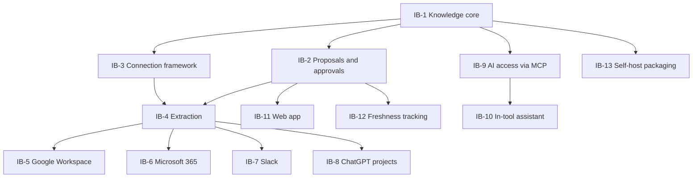

# Intent Backlog: Organisational Context Engine

Inputs: `ideation/intent-capture/intent-statement.md` (intent-statement), `ideation/feasibility/feasibility-assessment.md` (feasibility-assessment), `ideation/feasibility/constraint-register.md` (constraint-register) and `scope-definition-questions.md`.

**Prioritisation:** MoSCoW. You confirmed that every listed capability is a must-have (Q5). Items are ordered dependency-first: the more items depend on one, the earlier it comes (Q3).

## Backlog

| Order | ID | Capability (proto-Unit) | MoSCoW | Depends on | Depended on by | Source |
|---|---|---|---|---|---|---|
| 1 | IB-1 | **Knowledge core**: rules, processes, glossary, org map and decisions, with full history of who changed what, when and why | Must | none | IB-2 to IB-13 | intent-statement Q1, Q4 |
| 2 | IB-2 | **Change proposals and approvals** with simple roles | Must | IB-1 | IB-4, IB-9, IB-11 | intent-statement Q5, Q10 |
| 3 | IB-3 | **Connection framework**: a standard way to add any data source, including per-organisation privacy and sensitive-data settings with safe defaults | Must | IB-1 | IB-4, IB-5 to IB-8 | constraint-register TC-5, RC-1, RC-2 |
| 4 | IB-4 | **Extraction**: turns captured content into proposed knowledge linked to its source; pluggable AI models | Must | IB-2, IB-3 | IB-5 to IB-8 | intent-statement Q5, constraint-register TC-3 |
| 5 | IB-9 | **AI access through MCP** for ChatGPT, Claude and other agents | Must | IB-1 | IB-10 | constraint-register TC-6, Q4 |
| 6 | IB-11 | **Web app** for browsing, editing and approving | Must | IB-1, IB-2 | none | Q4 |
| 7 | IB-5 | **Google Workspace connection** (documents and files, Meet transcripts) | Must | IB-3, IB-4 | none | constraint-register TC-4 |
| 8 | IB-6 | **Microsoft 365 connection** (documents and files, Teams transcripts and chat) | Must | IB-3, IB-4 | none | constraint-register TC-4 |
| 9 | IB-7 | **Slack connection** (chat) | Must | IB-3, IB-4 | none | constraint-register TC-4 |
| 10 | IB-8 | **ChatGPT projects connection** (verify automated access first; fall back to file export) | Must | IB-3, IB-4 | none | constraint-register TC-4, feasibility-assessment |
| 11 | IB-10 | **In-tool assistant** to ask from inside Slack and Teams | Must | IB-9 | none | Q4 |
| 12 | IB-12 | **Freshness tracking** and reminders to rule owners | Must | IB-1, IB-2 | none | Q5, intent-statement Q12 |
| 13 | IB-13 | **Self-host packaging**: runs anywhere as containers, one organisation per installation, ready for open-source release | Must | IB-1 | none | constraint-register TC-1, TC-2, OC-5 |

## Dependency view

<!-- Text fallback: IB-1 Knowledge core comes first; Proposals and approvals, Connection framework, AI access via MCP and Self-host packaging depend on it. Extraction depends on Proposals and on the Connection framework. The four tool connections depend on Extraction. The Web app and Freshness tracking depend on Proposals. The In-tool assistant depends on AI access via MCP. -->

## Notes

- The four tool connections (IB-5 to IB-8) are independent of each other once IB-3 and IB-4 exist, so three tech leads can build them in parallel. (feasibility-assessment, constraint-register OC-1)
- IB-8 starts with an access check, because automated access to ChatGPT projects is not confirmed. (feasibility-assessment)

## Assumptions & Open Questions

- [assumption] Freshness tracking (IB-12) needs a named owner per rule; owner assignment is part of the knowledge core (IB-1).
