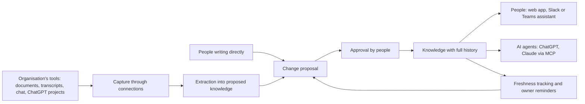

# Scope Document: Organisational Context Engine

Inputs: `ideation/intent-capture/intent-statement.md` (intent-statement), `ideation/feasibility/feasibility-assessment.md` (feasibility-assessment), `ideation/feasibility/constraint-register.md` (constraint-register), and the answers in `scope-definition-questions.md`.

## Scope statement

A self-hosted, open-source context engine that captures an organisation's business rules, processes, organisational map and decisions from people and from the tools they already use. It keeps a full history of every change, has people approve what goes in, and makes that knowledge available to people and AI agents every day. (intent-statement)

This is a proof of concept / minimum viable product. There is no fixed date, and no demo milestones are required. The first version includes every capability listed below. (Q1, Q2, Q7)

## In scope (first version)

| Area | What is included | Source |
|---|---|---|
| Knowledge held | Business rules and policies; processes, glossary and organisational map; decisions and their reasoning | intent-statement Q4 |
| History | Every change records who changed what, when and why | intent-statement Q1 |
| Authoring | People write and edit knowledge directly, through change proposals and approvals | intent-statement Q5 |
| Capture from tools | Google Workspace, Microsoft 365, Slack and ChatGPT projects: documents and files, meeting transcripts, and chat | constraint-register TC-4, intent-statement Q11 |
| Adding new sources | A standard way to add a connection to any other store of data | constraint-register TC-5 |
| Extraction | Content from connected tools becomes proposed knowledge that people approve before it is accepted | intent-statement Q5, Q5 (this stage) |
| AI access | AI agents and assistants (ChatGPT, Claude and others) read the knowledge through MCP | constraint-register TC-6, Q4 |
| Everyday use | Asking from inside existing tools (a Slack or Teams assistant, ChatGPT or Claude through MCP) | Q4 |
| Web app | A web app for browsing, editing and approving | Q4 |
| Freshness | Freshness tracking and reminders to rule owners | Q5 |
| Privacy and sensitive data | Each organisation chooses its privacy laws and security classifications and configures how sensitive chat and transcript content is handled, with safe defaults | constraint-register RC-1, RC-2, Q5 |
| AI models | Pluggable: each organisation chooses hosted or self-run models | constraint-register TC-3 |
| Roles | Simple roles only | constraint-register TC-8 |
| Packaging | Runs anywhere as containers; one organisation per installation; ready to release as open source | constraint-register TC-1, TC-2, OC-5 |

## Out of scope (first version)

| Item | Reason | Source |
|---|---|---|
| Fine-grained permissions | Simple roles only | intent-statement Q10 |
| One shared hosted service for many organisations | Each organisation runs its own copy | intent-statement Q13 |
| Fixed targets for the success metrics | Not important at this stage | Q2 |
| Demo milestones and fixed delivery dates | Not important; time is extended to include everything | Q1, Q7 |

## Sequencing principle

Build first whatever most other parts depend on. (Q3) The order is in `intent-backlog.md`.

## Value stream map

<!-- Text fallback: Content from the organisation's tools is captured through connections and extracted into proposed knowledge; people can also write directly. Both become change proposals that people approve. Approved knowledge is stored with full history and used by people (web app, Slack or Teams assistant) and AI agents (via MCP). Freshness tracking sends reminders to owners, which leads to new change proposals. -->

Every step stays inside the organisation's own installation; only the chosen AI model may sit outside it, if the organisation picks a hosted one. (constraint-register TC-1, TC-3)

## Risks carried forward

- The first version is broad, and the time frame is now open. The risk moves from missing a date to the project running long. (feasibility-assessment R-1, Q7)
- It is not yet confirmed that ChatGPT projects content can be read automatically. (feasibility-assessment)
- Chat and transcripts contain sensitive content, so safe defaults are required. (feasibility-assessment, constraint-register RC-2)

## Assumptions & Open Questions

- [assumption] "Ready to release as open source" means the code can be published; choosing a licence and publishing are outside this first version.
