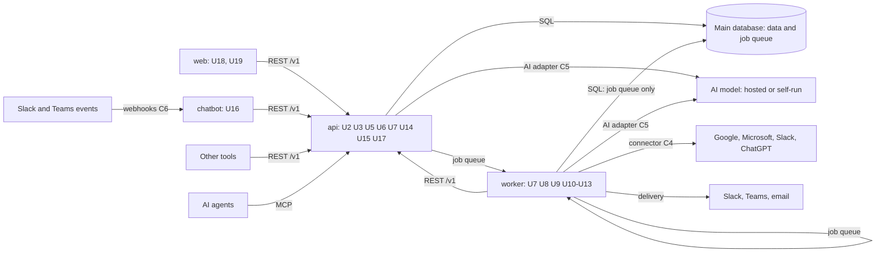

# Contract Summary: Organisational Context Engine

Inputs: `inception/units-generation/unit-of-work.md` (unit-of-work: 20 units, 4 containers), `inception/units-generation/unit-of-work-dependency.md` (unit-of-work-dependency: the DAG and its integration points), `inception/domain-design/components.md` (components: entity shapes and interaction styles), `inception/requirements-analysis/requirements.md` (requirements: FR and NFR targets), and the answers in `contract-design-questions.md` (Q1 to Q5, summary confirmed).

## How the system is cut

The units run as a modular monolith in four containers (unit-of-work, Q3 of Units Generation). That gives three kinds of boundary, and each kind gets a different contract mechanism:

| Boundary kind | Where | Mechanism (Q1, Q4) |
|---|---|---|
| Between containers and to the outside | `web`, `chatbot`, `worker` and other tools calling `api` | Public REST API `/v1`, JSON, OpenAPI (Q1, Q2) |
| Background work | `api` and `worker`, both ways | Durable job queue in the main database, behind a job interface, with a dead-letter queue (Q4) |
| Inside one container | Units sharing `api` or `worker` | Typed in-process module interfaces (TypeScript); no network hop |
| AI agents | Agents calling `api` | MCP, beside the REST API (Q2) |
| Third parties | Model providers, Slack, Teams, Google, Microsoft, email | The provider's own API, wrapped by one of our adapters |



<!-- Text fallback: The web container, the chatbot container, the worker and other tools all call the api container over the public REST API /v1. AI agents call the api over MCP. The api and the worker pass background work to each other through the job queue kept in the main database; the worker only touches the database for the job queue, and reads and writes knowledge through the REST API. Both the api and the worker reach the AI model through the AI adapter (C5). The worker reads source tools through connectors (C4) and delivers notifications to Slack, Teams and email. Slack and Teams send chat events to the chatbot through webhooks (C6). -->

## Contracts

| # | Provider Unit | Consumer | Mechanism | Owner |
|---|---|---|---|---|
| C1 | `api` (U2, U3, U6, U7, U8, U14, U17; U1 first slice) | U18, U19 (`web`), U16 (`chatbot`), U9 and U7 delivery (`worker`), External: other tools | REST/HTTP JSON, OpenAPI 3.1, `/v1` | Each resource group is owned by the unit named on its tag; U1 owns the shared conventions |
| C2 | U15 (`api`) | External: AI agents (for example Claude) | MCP over Streamable HTTP | U15 |
| C3 | Job interface (U1 creates; U8, U9, U7, U6, U2 publish or consume) | `worker` and `api` job handlers | Durable job queue in the main database, AsyncAPI-described job types, dead-letter queue | U1 owns the interface; each job type is owned by its publisher |
| C4 | U8 | U10, U11, U12, U13 and any future connection | In-process library interface (connector contract) | U8 |
| C5 | U4 | U5, U9, U14, U17, U19 (settings); External: model provider behind it | In-process library interface plus HTTP to the provider | U4 |
| C6 | U16 | External: Slack and Microsoft Teams (inbound events) | Platform webhooks / events, verified by signature | U16 (adapter); the platforms own the payloads |
| C7 | U3, U5, U2 (in-process providers) | U6, U7, U14, U17 (same container) | In-process module interfaces | Provider unit of each interface |
| C8 | Every container (U1 creates; U20 hardens) | External: container host, CI deploy check, monitoring | HTTP health and metrics endpoints | U1, then U20 |

### C1 Public REST API `/v1`

One API serves our own web app, chat bot and worker, and other organisations' tools. It is public, documented and versioned (Q2). The full OpenAPI document lives in the repository as `api/openapi/v1.yaml` and is the single source of truth: server routes and the TypeScript client used by `web`, `chatbot` and `worker` are checked against it in CI. Below is the contract skeleton every unit builds on; each owning unit fills in its own paths in its design stages, inside these rules.

```yaml
openapi: 3.1.0
info:
  title: Organisational Context Engine API
  version: 1.0.0
  description: >
    Public API for knowledge items, links, proposals and decisions, search and answers,
    notifications, connections and settings. Errors use RFC 9457 problem details.
servers:
  - url: https://{host}/v1
    variables:
      host: { default: localhost:8080 }
security:
  - session: []
  - serviceToken: []
tags:
  - { name: identity, description: "Owner: U2. Users, roles, service accounts, chat identities" }
  - { name: settings, description: "Owner: U2 (OrgSettings) and U4 (AI model)" }
  - { name: items, description: "Owner: U3. Items, versions, links, history, graph" }
  - { name: proposals, description: "Owner: U6. Drafts, proposals, decisions, gap requests" }
  - { name: assessments, description: "Owner: U5 via U6 and U14. Impact and risk" }
  - { name: query, description: "Owner: U14. Search, answers, conversations, life summaries" }
  - { name: simulation, description: "Owner: U17. Sandboxes and scenarios" }
  - { name: notifications, description: "Owner: U7. Inbox, preferences, freshness" }
  - { name: connections, description: "Owner: U8. Connections, scopes, uploads, health" }
paths:
  /me:
    get: { tags: [identity], summary: Current user or service account and role, operationId: getMe }
  /users:
    get: { tags: [identity], summary: List users (Admin), operationId: listUsers, parameters: [ { $ref: "#/components/parameters/cursor" }, { $ref: "#/components/parameters/limit" } ] }
  /users/{userId}:
    patch: { tags: [identity], summary: Change role or deactivate (Admin), operationId: updateUser }
  /service-accounts:
    post: { tags: [identity], summary: Create a service account for an AI agent or tool (Admin), operationId: createServiceAccount }
  /settings/organisation:
    get: { tags: [settings], operationId: getOrgSettings }
    put: { tags: [settings], summary: Update settings (Admin); refuses a brand colour that fails contrast, operationId: putOrgSettings }
  /settings/ai-model:
    put: { tags: [settings], summary: Configure hosted or self-run model (Admin); keys are write-only, operationId: putModelConfig }
  /settings/ai-model/test:
    post: { tags: [settings], summary: Test the model connection, operationId: testModel }
  /items:
    get:
      tags: [items]
      summary: List or filter approved items
      operationId: listItems
      parameters:
        - { name: type, in: query, schema: { $ref: "#/components/schemas/ItemType" } }
        - { name: ownerId, in: query, schema: { type: string } }
        - { name: team, in: query, schema: { type: string } }
        - { name: status, in: query, schema: { type: string, enum: [current, stale, archived] } }
        - { $ref: "#/components/parameters/cursor" }
        - { $ref: "#/components/parameters/limit" }
      responses:
        "200": { description: A page of items, content: { application/json: { schema: { $ref: "#/components/schemas/ItemPage" } } } }
        default: { $ref: "#/components/responses/Problem" }
  /items/{itemId}:
    get:
      tags: [items]
      operationId: getItem
      responses:
        "200": { description: The item with its current version, links, owner and freshness, headers: { ETag: { schema: { type: string } } }, content: { application/json: { schema: { $ref: "#/components/schemas/Item" } } } }
        "404": { $ref: "#/components/responses/Problem" }
  /items/{itemId}/versions:
    get: { tags: [items], summary: Full append-only history, operationId: listItemVersions }
  /items/{itemId}/links:
    get: { tags: [items], operationId: listItemLinks }
  /items/{itemId}/confirmations:
    post: { tags: [notifications], summary: Owner confirms "still correct"; resets the review date, operationId: confirmItem }
  /graph:
    get: { tags: [items], summary: Nodes and links for the map, optionally at a point in time, operationId: getGraph }
  /drafts:
    post: { tags: [proposals], operationId: createDraft }
  /proposals:
    get: { tags: [proposals], summary: Reviews inbox; filter mine, origin, status, operationId: listProposals }
    post:
      tags: [proposals]
      summary: Raise a proposal (web editor, extraction, MCP agent or tool)
      operationId: createProposal
      parameters:
        - { $ref: "#/components/parameters/idempotencyKey" }
      requestBody:
        required: true
        content: { application/json: { schema: { $ref: "#/components/schemas/NewProposal" } } }
      responses:
        "201": { description: Created; the same Idempotency-Key returns the same proposal, content: { application/json: { schema: { $ref: "#/components/schemas/Proposal" } } } }
        "403": { $ref: "#/components/responses/Problem" }
        "422": { $ref: "#/components/responses/Problem" }
  /proposals/{proposalId}:
    get: { tags: [proposals], summary: Proposal with its latest assessment and out-of-date state, operationId: getProposal }
  /proposals/{proposalId}/decisions:
    post:
      tags: [proposals]
      summary: Approve, request changes or reject; override for Admins; reason required to reject
      operationId: decideProposal
      parameters:
        - { name: If-Match, in: header, required: true, schema: { type: string }, description: ETag of the proposal as the decider saw it }
      requestBody:
        required: true
        content: { application/json: { schema: { $ref: "#/components/schemas/NewDecision" } } }
      responses:
        "201": { description: Decision recorded }
        "409": { $ref: "#/components/responses/Problem" }
        "412": { $ref: "#/components/responses/Problem" }
  /proposals/{proposalId}/withdrawal:
    post: { tags: [proposals], operationId: withdrawProposal }
  /gap-requests:
    post: { tags: [proposals], operationId: createGapRequest, parameters: [ { $ref: "#/components/parameters/idempotencyKey" } ] }
  /assessments:
    post: { tags: [assessments], summary: Assess a draft or described change (live preview); never stored as a proposal, operationId: assessChange }
  /query/search:
    get: { tags: [query], summary: Role-checked search over approved knowledge, operationId: search }
  /query/answers:
    post: { tags: [query], summary: Answer from approved knowledge with citations, pending and stale labels, operationId: answer }
  /conversations:
    post: { tags: [query], operationId: createConversation }
  /conversations/{conversationId}/messages:
    post: { tags: [query], operationId: postConversationMessage }
  /items/{itemId}/life-summary:
    get: { tags: [query], operationId: getLifeSummary }
  /sandboxes:
    post: { tags: [simulation], operationId: createSandbox }
  /sandboxes/{sandboxId}/scenarios:
    post: { tags: [simulation], operationId: runScenario }
  /sandboxes/{sandboxId}/draft:
    post: { tags: [simulation], summary: Turn the sandbox into a draft, operationId: sandboxToDraft }
  /notifications:
    get: { tags: [notifications], operationId: listNotifications }
  /notification-preferences:
    put: { tags: [notifications], operationId: putNotificationPreferences }
  /me/items/attention:
    get: { tags: [notifications], summary: My stale and due-soon items, operationId: listMyAttentionItems }
  /connections:
    get: { tags: [connections], summary: Status and last good sync per connection, operationId: listConnections }
    post: { tags: [connections], operationId: createConnection }
  /connections/{connectionId}:
    patch: { tags: [connections], summary: Scopes, enable or disable, operationId: updateConnection }
  /uploads:
    post: { tags: [connections], summary: Upload a document (multipart), operationId: uploadDocument, parameters: [ { $ref: "#/components/parameters/idempotencyKey" } ] }
  /source-documents/{sourceDocumentId}:
    get: { tags: [connections], summary: Excerpt follows item visibility; raw content Admin-only by default, operationId: getSourceDocument }
components:
  securitySchemes:
    session: { type: apiKey, in: cookie, name: session, description: Browser session issued by the authentication library (U2) }
    serviceToken: { type: http, scheme: bearer, description: Service-account token; the account's role limits every call }
  parameters:
    cursor: { name: cursor, in: query, schema: { type: string } }
    limit: { name: limit, in: query, schema: { type: integer, minimum: 1, maximum: 200, default: 50 } }
    idempotencyKey: { name: Idempotency-Key, in: header, required: true, schema: { type: string, maxLength: 200 }, description: Same key within 24 hours returns the first result instead of creating a duplicate }
  responses:
    Problem:
      description: RFC 9457 problem details
      content: { application/problem+json: { schema: { $ref: "#/components/schemas/Problem" } } }
  schemas:
    Problem:
      type: object
      required: [type, title, status]
      properties:
        type: { type: string, format: uri, description: "https://{host}/problems/<code>" }
        title: { type: string }
        status: { type: integer }
        detail: { type: string }
        instance: { type: string }
        code: { type: string, enum: [unauthenticated, forbidden, not-found, validation-failed, reason-required, proposal-out-of-date, already-decided, not-an-approver, conflict, rate-limited, ai-unavailable, dependency-unavailable, internal] }
        errors: { type: array, items: { type: object, properties: { field: { type: string }, message: { type: string } } } }
    ItemType: { type: string, enum: [rule, process, glossary-term, person, team, system, decision] }
    Item:
      type: object
      required: [itemId, type, title, status, version]
      properties:
        itemId: { type: string }
        type: { $ref: "#/components/schemas/ItemType" }
        title: { type: string }
        content: { type: string }
        why: { type: string }
        typeFields: { type: object, additionalProperties: true }
        owner: { type: [object, "null"], properties: { userId: { type: string }, displayName: { type: string } } }
        status: { type: string, enum: [current, stale, archived] }
        reviewPeriodDays: { type: integer }
        lastReviewedAt: { type: string, format: date-time }
        version: { type: object, properties: { versionId: { type: string }, versionNumber: { type: integer }, approvedBy: { type: string }, approvedAt: { type: string, format: date-time } } }
        links: { type: array, items: { $ref: "#/components/schemas/Link" } }
        sources: { type: array, items: { type: object, properties: { sourceDocumentId: { type: string }, url: { type: string }, excerpt: { type: string } } } }
        pendingProposalIds: { type: array, items: { type: string } }
    ItemPage:
      type: object
      properties:
        items: { type: array, items: { $ref: "#/components/schemas/Item" } }
        nextCursor: { type: [string, "null"] }
    Link:
      type: object
      properties:
        linkId: { type: string }
        fromItemId: { type: string }
        toItemId: { type: string }
        linkType: { type: string }
    NewProposal:
      type: object
      required: [kind, reason, changes]
      properties:
        kind: { type: string, enum: [create, change, archive, link, unlink] }
        reason: { type: string, minLength: 1 }
        changes: { type: array, items: { type: object, required: [baseVersionId], properties: { itemId: { type: string }, baseVersionId: { type: [string, "null"] }, title: { type: string }, content: { type: string }, why: { type: string }, typeFields: { type: object }, links: { type: array, items: { $ref: "#/components/schemas/Link" } } } } }
        sourceRefs: { type: array, items: { type: object, properties: { sourceDocumentId: { type: string }, excerpt: { type: string } } } }
    Proposal:
      type: object
      properties:
        proposalId: { type: string }
        kind: { type: string }
        origin: { type: string, enum: [web, extraction, agent, conversation, tool] }
        proposer: { type: object, properties: { id: { type: string }, kind: { type: string, enum: [user, service-account] } } }
        status: { type: string, enum: [open, changes-requested, approved, rejected, withdrawn, out-of-date] }
        requiredApprovers: { type: array, items: { type: string } }
        assessment: { $ref: "#/components/schemas/Assessment" }
        createdAt: { type: string, format: date-time }
    NewDecision:
      type: object
      required: [outcome]
      properties:
        outcome: { type: string, enum: [approve, request-changes, reject] }
        comment: { type: string, description: Required for reject, request-changes and override }
        override: { type: boolean, default: false }
        winningVersionId: { type: string, description: Required when the proposal is out of date }
    Assessment:
      type: object
      properties:
        status: { type: string, enum: [complete, contradiction-check-unavailable] }
        riskLevel: { type: string, enum: [low, medium, high] }
        reasons: { type: array, items: { type: string } }
        directlyAffected: { type: array, items: { type: string } }
        oneLinkFurther: { type: array, items: { type: string } }
        contradictions: { type: array, items: { type: object, properties: { itemId: { type: string }, explanation: { type: string } } } }
```

**C1 rules every unit follows:**
- **Versioning (Q3).** Major version in the path. Inside `/v1` only additive changes: new paths, new optional fields, new enum values. Consumers ignore unknown fields and treat unknown enum values as "other". A breaking change needs `/v2`, and `/v1` is kept for at least one release after `/v2` ships, with a `Deprecation` header and a `Sunset` date.
- **Errors (Q5).** Every non-2xx response is `application/problem+json` with a stable `code` from the list above. Item or source content never appears in `detail` (NFR6).
- **Timeouts and retries (Q5).** Callers time out API calls at 10 seconds, and calls that wait on the AI model (`/query/answers`, `/conversations/*`, `/assessments`, `/sandboxes/*/scenarios`) at 30 seconds. Up to 3 retries with exponential backoff and jitter (0.5 s, 1 s, 2 s), only for `GET`, `PUT`, `DELETE` and for `POST` calls that carry an `Idempotency-Key`, and only on network errors, `429`, `502`, `503` and `504`. `429` and `503` carry `Retry-After`, which callers respect.
- **Idempotency (Q5).** `POST /proposals`, `POST /gap-requests` and `POST /uploads` require `Idempotency-Key`. Extraction uses the source document id plus content hash as the key, which backs FR6.3 (no duplicate proposal).
- **One decision only (FR3.5, U6).** A decision sends `If-Match` with the proposal's ETag. A second decision by the same owner returns `409 already-decided`; a stale ETag returns `412`; a proposal whose base changed returns `409 proposal-out-of-date` until the decider names `winningVersionId`.
- **Authentication and roles (FR11, NFR5).** Browsers use the session cookie issued by U2's authentication library. `chatbot`, `worker`, MCP agents and other tools use service-account bearer tokens. The server checks the role on every request. The `chatbot` acts for the matched person by sending `X-Acting-Chat-Identity: <platform>:<externalUserId>`; `api` accepts that header only from the chat service account, resolves it to a user through the chat identity link, and applies that user's role. An unmatched identity gets `403 forbidden`.
- **Worker access.** The worker reads and writes knowledge only through this API, under an extraction service account with the Contributor role, so extracted proposals go through the same checks as every other proposal. It touches the database directly only for the job queue (C3).
- **Pagination.** Cursor-based (`cursor`, `limit`, `nextCursor`).

### C2 MCP server

AI agents use MCP, served by U15 inside `api` at `/mcp` (Streamable HTTP). Each agent authenticates with a service-account bearer token; the account's role limits every tool, and Readers cannot propose (FR7.4, FR11.5). MCP tools are thin wrappers over C1 operations, so the rules above (errors, idempotency, role checks) apply unchanged.

```yaml
mcp:
  server: { name: context-engine, version: 1.0.0, transport: streamable-http, path: /mcp }
  auth: { scheme: bearer, principal: service-account }
  tools:
    - name: search_knowledge
      maps_to: GET /v1/query/search
      input: { query: string, type: ItemType?, limit: integer? }
      output: "results[]: itemId, title, type, status (approved | pending | stale), owner, lastReviewedAt, url"
    - name: get_item
      maps_to: GET /v1/items/{itemId}
      input: { itemId: string }
      output: "item with links, owner, freshness, sources; pendingProposalIds listed separately from approved content"
    - name: get_item_links
      maps_to: GET /v1/items/{itemId}/links
      input: { itemId: string }
    - name: ask
      maps_to: POST /v1/query/answers
      input: { question: string }
      output: "answer with citations; every claim marked approved or pending (FR7.2)"
    - name: propose_change
      maps_to: POST /v1/proposals
      input: { kind: string, reason: string, changes: array, idempotencyKey: string }
      output: "proposalId and status open; origin recorded as agent (FR7.3)"
      requires_role: Contributor
  errors: "tool errors return isError true with the C1 problem code and title"
  versioning: "tool names and inputs follow the C1 additive-only rule; a breaking change adds a new tool name"
```

### C3 Background work: job queue in the main database

Background work goes through one job interface (Q4). The first implementation stores jobs in the main database, using an established Postgres job-queue library (for example pg-boss or graphile-worker, chosen in the tech-stack decision), per the project rule to use proven libraries. A job is written in the same transaction as the change that caused it, so a crash never leaves a change without its job, or a job without its change (NFR10). A broker can replace the implementation later by writing a new adapter for the same interface.

**Job interface (owned by U1, used by every publisher and handler):**

```yaml
shared-schema:
  name: JobQueue
  owner: u1-walking-skeleton
  operations:
    enqueue: { input: "type, payload, idempotencyKey?, runAfter?, transaction?", output: jobId, note: "inside the caller's database transaction when given" }
    take: { input: "types[], batchSize", output: "jobs[]", note: "lease-based; safe with several worker copies" }
    complete: { input: jobId }
    fail: { input: "jobId, error, retryable (boolean)", note: "retryable failures back off; non-retryable failures count as an attempt" }
    defer: { input: "jobId, until, reason", note: "for outages: re-schedules without using up an attempt" }
    deadLetters: { input: "type?, cursor", output: "DeadLetter[]" }
    retryDeadLetter: { input: deadLetterId }
    discardDeadLetter: { input: "deadLetterId, reason" }
  job:
    jobId: string
    type: string
    version: integer
    payload: object
    idempotencyKey: string?
    attempts: integer
    maxAttempts: 3
    createdAt: date-time
    runAfter: date-time
  deadLetter:
    deadLetterId: string
    job: job
    lastError: "code and message, never item or source content (NFR6)"
    attempts: integer
    deadLetteredAt: date-time
    retentionDays: 30
  policy:
    retry: "up to 3 attempts, exponential backoff with jitter (Q5)"
    ai_unavailable: "when C5 returns unavailable, the handler calls defer (back off up to 5 minutes, repeating) and the attempt is not counted"
    dead_letter: "after maxAttempts the job moves to the dead-letter queue with payload, error and attempts"
    alert: "dead-letter count per job type is a metric; above zero raises an alert (NFR13)"
    admin: "Admins see dead letters per connection or job type, and retry or discard them; each action is recorded"
    handlers: "must be idempotent: a job can run more than once"
```

**Job types:**

```yaml
asyncapi: 3.0.0
info:
  title: Context Engine background jobs
  version: 1.0.0
  description: Job types carried by the JobQueue interface. Payloads hold ids and hashes, never content.
channels:
  contentChanged:
    address: content.changed
    messages: { ContentChanged: { $ref: "#/components/messages/ContentChanged" } }
  notificationDeliver:
    address: notification.deliver
    messages: { NotificationDeliver: { $ref: "#/components/messages/NotificationDeliver" } }
  userDeactivated:
    address: user.deactivated
    messages: { UserDeactivated: { $ref: "#/components/messages/UserDeactivated" } }
  connectionSync:
    address: connection.sync
    messages: { ConnectionSync: { $ref: "#/components/messages/ConnectionSync" } }
  freshnessDailyCheck:
    address: freshness.daily-check
    messages: { FreshnessDailyCheck: { $ref: "#/components/messages/FreshnessDailyCheck" } }
operations:
  publishContentChanged: { action: send, channel: { $ref: "#/channels/contentChanged" }, description: "U8 (worker sync, api upload)" }
  consumeContentChanged: { action: receive, channel: { $ref: "#/channels/contentChanged" }, description: "U9 extraction (worker)" }
  publishNotificationDeliver: { action: send, channel: { $ref: "#/channels/notificationDeliver" }, description: "U7 in api, when U6 or U7 freshness create a notification" }
  consumeNotificationDeliver: { action: receive, channel: { $ref: "#/channels/notificationDeliver" }, description: "U7 delivery (worker): Slack, Teams, email" }
  publishUserDeactivated: { action: send, channel: { $ref: "#/channels/userDeactivated" }, description: "U2 (api)" }
  consumeUserDeactivated: { action: receive, channel: { $ref: "#/channels/userDeactivated" }, description: "U3 unowns items; U6 reroutes waiting proposals (api)" }
  consumeConnectionSync: { action: receive, channel: { $ref: "#/channels/connectionSync" }, description: "U8 sync per connection on its schedule (worker)" }
  consumeFreshnessDailyCheck: { action: receive, channel: { $ref: "#/channels/freshnessDailyCheck" }, description: "U7 daily staleness run (worker), scheduled once a day" }
components:
  messages:
    ContentChanged:
      payload:
        type: object
        required: [sourceDocumentId, connectionId, contentHash, changedAt]
        properties:
          sourceDocumentId: { type: string }
          connectionId: { type: string }
          contentHash: { type: string, description: "idempotency key with sourceDocumentId (FR6.3)" }
          changedAt: { type: string, format: date-time, description: "time saved in the source; NFR1 latency is measured from here" }
    NotificationDeliver:
      payload:
        type: object
        required: [notificationId, channel]
        properties:
          notificationId: { type: string }
          channel: { type: string, enum: [slack, teams, email] }
    UserDeactivated:
      payload:
        type: object
        required: [userId, deactivatedAt]
        properties:
          userId: { type: string }
          deactivatedAt: { type: string, format: date-time }
    ConnectionSync:
      payload: { type: object, required: [connectionId], properties: { connectionId: { type: string } } }
    FreshnessDailyCheck:
      payload: { type: object, required: [runDate], properties: { runDate: { type: string, format: date } } }
```

Delivery failures to Slack, Teams or email are retried per the policy and never block the action that caused them (components: Notifications). The web-app inbox entry is written in `api` directly, so it never waits on the queue.

### C4 Connector contract (U8 to U10 to U13)

The standard way to add a source without changing the core (FR5.1). Every connector is a library inside `worker` that implements this interface; U8 owns scheduling, storage under the sensitive-content policy, health and failure isolation (FR5.8).

```yaml
shared-schema:
  name: Connector
  owner: u8-ingestion-framework
  kind_id: "string, unique: google-workspace | microsoft-365 | slack | chatgpt-projects | upload | <new>"
  operations:
    describeScopes: { input: credentials, output: "ScopeOption[] (folders, channels, meetings) for the Admin to choose (FR12.4)" }
    testConnection: { input: credentials, output: "ok | error(code, message)" }
    listChanges: { input: "scopes, cursor", output: "changes[], nextCursor", note: "incremental; a first run lists everything in scope" }
    fetchDocument: { input: externalId, output: FetchedDocument }
  FetchedDocument:
    externalId: string
    kind: "document | message | transcript | export"
    title: string
    text: string
    author: string?
    sourceTimestamp: date-time
    url: string
    rawContent: "bytes?; stored or dropped by U8 per the sensitive-content policy (FR12.2)"
  errors:
    auth-expired: "connection marked failing; Admin notified; other connections continue"
    rate-limited: "retry after the provider's delay"
    unavailable: "retryable"
    not-supported: "for example ChatGPT automated access missing; U13 falls back to file import (FR5.5)"
  rules:
    - "U8 computes contentHash and publishes content.changed only when the hash changed"
    - "a connector never writes to the database or calls the API itself"
    - "credentials are read from the secret store by U8 and passed in; connectors never log them (NFR5)"
```

### C5 AI gateway (U4)

One in-process interface for every model call; no other unit knows whether the model is hosted or self-run (FR6.4, FR12.3).

```yaml
shared-schema:
  name: AIGateway
  owner: u4-ai-gateway
  operations:
    complete:
      input: "task (extract | answer | summarise | contradiction | scenario | draft), prompt, outputSchema?, timeoutMs (default 30000)"
      output: "Result"
    testConnection: { output: "ok | error(code, message)" }
  Result:
    oneOf:
      - { status: ok, output: "validated against outputSchema when given" }
      - { status: invalid-output, detail: "validation errors; the call is not retried automatically" }
      - { status: unavailable, reason: "timeout | connection | rate-limited | provider-error" }
  rules:
    - "timeout 30 seconds per call (Q5)"
    - "unavailable is a normal result, not an exception: callers degrade (U5 marks contradiction check unavailable; U14 says it cannot answer; U9 defers the job)"
    - "provider keys come from the secret store and are never returned or logged"
    - "prompts and outputs are not logged (NFR6)"
  provider_side:
    hosted: "the provider's own HTTP API (for example Anthropic Messages API)"
    self_run: "an OpenAI-compatible chat completions endpoint configured by the Admin"
```

### C6 Chat platforms to the chat bot (U16)

Slack and Teams send events to `chatbot`; the platforms own those payloads, so our contract is the adapter rule set rather than a schema.

```yaml
inbound:
  slack: { mechanism: "Events API over HTTPS, or Socket Mode", verification: "signing secret on every request" }
  teams: { mechanism: "Bot Framework activities over HTTPS", verification: "Bot Framework JWT" }
rules:
  - "acknowledge within the platform's limit (Slack 3 seconds), then answer asynchronously in the thread"
  - "call C1 /v1/query/answers with X-Acting-Chat-Identity; never cache answers across users"
  - "unmatched user: reply that they need an invite; no knowledge returned (components: ChatAssistant)"
  - "api unreachable or 30-second timeout: reply that the engine is unavailable (U16)"
  - "replies show the answer, owner, last reviewed date when stale, and a link to the item (FR8)"
```

### C7 In-process interfaces inside `api`

These units share the `api` container (unit-of-work-dependency, integration points), so they call each other as typed TypeScript modules. Each provider exports one interface from its module's `index`; other modules import only that, never internal files or tables. A lint rule enforces this module boundary.

```yaml
shared-schema:
  - interface: KnowledgeGraphWriter
    owner: u3-knowledge-graph
    consumer: u6-proposal-workflow
    operations:
      applyApprovedChange: "proposalId, changes[], approvedBy -> new versionIds; one transaction; refuses if a base version moved"
      currentVersions: "itemIds[] -> versionIds[] (for out-of-date detection)"
      owners: "itemIds[] -> ownerId or null"
  - interface: KnowledgeGraphReader
    owner: u3-knowledge-graph
    consumer: [u5-impact-assessment, u6-proposal-workflow, u7-notifications-freshness, u14-knowledge-query, u17-simulation]
    operations:
      getItems: "itemIds[], atVersion? -> Item[]"
      neighbours: "itemIds[], depth (1 or 2) -> Link[] and Item ids"
      search: "query, filters, role -> results (approved only)"
      staleItems: "asOf -> Item[]"
  - interface: ImpactAssessment
    owner: u5-impact-assessment
    consumer: [u6-proposal-workflow, u14-knowledge-query, u17-simulation]
    operations:
      assess: "subject (proposal | draft | sandbox), changes[] -> Assessment; status contradiction-check-unavailable when C5 is unavailable (FR4)"
  - interface: Access
    owner: u2-identity-admin
    consumer: "every unit in api"
    operations:
      check: "principal, action, resource -> allow | deny(reason)"
      approvers: "-> userIds with Approver or Admin role"
      resolveChatIdentity: "platform, externalUserId -> userId or none"
  - interface: Notify
    owner: u7-notifications-freshness
    consumer: [u6-proposal-workflow, u7-notifications-freshness]
    operations:
      notify: "recipientId, kind, subjectRef -> notificationId; writes the inbox entry and enqueues notification.deliver in the caller's transaction"
```

### C8 Health and metrics

Every container exposes the same endpoints for the container host, the CI deploy check ("done means healthy", team practice) and monitoring (NFR13).

```yaml
openapi: 3.1.0
info: { title: Container health, version: 1.0.0 }
paths:
  /healthz:
    get: { summary: "Liveness: the process is running", responses: { "200": { description: ok } } }
  /readyz:
    get:
      summary: "Readiness: database reachable (and, for worker, job queue reachable)"
      responses:
        "200": { description: ready }
        "503": { description: not ready, content: { application/problem+json: {} } }
  /metrics:
    get: { summary: "Prometheus text format: error rate, request latency, proposal latency (NFR1), sync status per connection, job queue depth, dead-letter count", responses: { "200": { description: metrics } } }
```

The AI model and connections are deliberately not part of readiness: a failing model or connection must not take the service down (NFR10).

## Contract ownership rules

- **Who owns what.** The provider unit owns its contract and its part of the spec file. For C1, each tag's owner (listed on the tag) owns those paths and schemas; U1 owns the shared parts (problem format, pagination, security schemes, idempotency). For C3, U1 owns the job interface and each publisher owns its job type's payload.
- **Spec first.** A change to C1, C2 or a C3 job type starts as a change to the spec in the same pull request as the code. CI checks routes against the OpenAPI file and fails on a breaking change inside `/v1` (an OpenAPI diff check).
- **Additive changes are safe.** New optional fields, paths, tools, job types and enum values need only the owner's review. Consumers ignore unknown fields and unknown job types.
- **Breaking changes are agreed.** They need a new major version (`/v2`, a new tool name, or a new job `version`), approval from a tech lead of every consuming unit in the pull request, and the old version kept for at least one release (Q3).
- **In-process interfaces (C4, C5, C7).** Changing them is a code change reviewed by the owner and the consumers' tech leads; the TypeScript compiler and the module-boundary lint rule catch breaks.
- **Contract tests.** Each consumer keeps tests against the spec (C1, C2, C3 payloads), written before the code per the team's tests-first practice, and each provider runs them in CI.

## Open questions

| Contract | Question | Blocks |
|---|---|---|
| C7 | If U3's graph traversal or U5's assessment is written in Rust, these interfaces become a native module binding or a separate service. Decided in the tech-stack choice. | U3, U5 |
| C3 | Which Postgres job-queue library (pg-boss, graphile-worker or another). It must support leases, delayed runs and dead letters, or dead letters built on top. Decided in the tech-stack choice. | U1 |
| C1 | Which authentication library, which fixes the session cookie and token format. | U1, U2 |
| C1 | Rate limits for the public API (per token, per minute). Set in NFR design. | U20 |
| C4 | Whether ChatGPT projects offer automated access; if not, U13 uses file import only (requirements A6). | U13 |
| C6 | Whether Socket Mode (no public inbound URL) is the default for Slack in self-hosted installs. | U16 |

## Sources

- Initial description: see `<record>/project-description.json`.
- `inception/units-generation/unit-of-work.md`: containers, units and their responsibilities.
- `inception/units-generation/unit-of-work-dependency.md`: the DAG and the integration points table this document formalises.
- `inception/domain-design/components.md`: entity shapes, interaction styles (sync, async, event) and failure behaviour.
- `inception/requirements-analysis/requirements.md`: FR1 to FR13 and NFR1 to NFR13.
- `contract-design-questions.md`: Q1 REST with OpenAPI; Q2 public documented API; Q3 path versioning, additive only; Q4 job queue in the main database behind a swappable interface, with a dead-letter queue; Q5 problem details, timeouts, retries and idempotency.
- Project rule (project.md, Corrections): use established, proven libraries.
