# Bolt Plan

A **Bolt** is one build pass over a piece of the work that ends in something that runs. This plan puts the 20 units from `inception/units-generation/unit-of-work.md` into 18 Bolts, in the order we intend to build them.

Decisions behind this plan (`delivery-planning-questions.md`):
- After the thin end-to-end slice, riskiest first, then value [Q1].
- One unit per Bolt; very small units that only make sense together are bundled [Q2].
- One unit at a time: each unit goes through its design steps and its code, and a person checks it before the next starts [Q3]. Recorded as Construction Iteration `unit-major`, Execution `serial`.
- The 6 open contract concerns are fixed in the design of the unit each one touches [Q4]; see "Contract concerns by Bolt" below.

Each Bolt merges into `main` as several small pull requests (branches live 1 to 2 days, another tech lead approves each one, squash-merged), and every merge deploys to our own live copy (`team-practices.md`). Every Bolt's Definition of Done also includes the team's standing rules: tests written first, at least 80% line coverage, lint and format checks passing, CI green.

> The build order the workflow actually walks comes from the dependency graph in `unit-of-work-dependency.md`. This plan is a valid order through that graph and records why; it does not by itself change which unit is built next.

## Sequence at a glance

| Bolt | Units | Why here |
|---|---|---|
| B1 | U1 walking skeleton | First in every valid order; proves every layer connects |
| B2 | U3 knowledge graph | Everything else reads or writes items |
| B3 | U4 AI gateway + U5 impact assessment | First AI call, proven early (risk) |
| B4 | U2 identity and admin | Needed by ingestion, notifications and approvals |
| B5 | U8 ingestion framework + U13 ChatGPT connector | Checks ChatGPT projects access early (risk R-3) |
| B6 | U10 Google connector | One real connection for the extraction check |
| B7 | U7 notifications and freshness | Needed by the proposal workflow |
| B8 | U6 proposal workflow | The heart of approvals |
| B9 | U9 extraction | Proves the 5-minute target end to end (risks R-1, R-4) |
| B10 | U19 change and admin screens | Approval and editing usability, the team's biggest worry (R-5) |
| B11 | U11 Microsoft connector | Second connection family |
| B12 | U12 Slack connector | Third connection family |
| B13 | U14 knowledge query (Ask) | Answers from approved knowledge |
| B14 | U15 MCP server | AI agents read and propose |
| B15 | U16 chat assistant | Slack and Teams bots |
| B16 | U17 simulation | Needed by the explore screens |
| B17 | U18 explore screens | Map, item pages, Ask, Simulate |
| B18 | U20 release packaging | First public release |

```mermaid
graph LR
    B1[B1 U1] --> B2[B2 U3] --> B3[B3 U4+U5] --> B4[B4 U2] --> B5[B5 U8+U13] --> B6[B6 U10] --> B7[B7 U7] --> B8[B8 U6] --> B9[B9 U9] --> B10[B10 U19] --> B11[B11 U11] --> B12[B12 U12] --> B13[B13 U14] --> B14[B14 U15] --> B15[B15 U16] --> B16[B16 U17] --> B17[B17 U18] --> B18[B18 U20]
```

<!-- Text fallback: B1 (U1), B2 (U3), B3 (U4 and U5), B4 (U2), B5 (U8 and U13), B6 (U10), B7 (U7), B8 (U6), B9 (U9), B10 (U19), B11 (U11), B12 (U12), B13 (U14), B14 (U15), B15 (U16), B16 (U17), B17 (U18), B18 (U20), one after another. -->

## Bolts

### B1: U1 walking skeleton (walking skeleton)
- **Walking skeleton:** yes. The walking skeleton is the smallest working slice through every layer; it is built, checked end to end and approved by a person before any later unit starts (team Walking Skeleton practice).
- **Proves:** repository layout, the `api`, `worker` and `web` containers, the local container setup and GitHub Actions CI; an item stored with append-only versions; a basic proposal approved by its owner; a basic web page; an MCP read tool; seeded sign-in.
- **Definition of Done:** the end-to-end check passes from the containers: start them, create an item, approve it as its owner, read it in the page and through MCP. The job-queue library (contract C3) and the authentication library (contract C1) are chosen, because U1 and U2 depend on them (`contract-summary.md` open questions).
- **Confidence hypothesis:** the four layers (store, approval, web, MCP) connect inside containers with CI enforcing the team's test and coverage rules.
- **Expected demo:** a contributor writes an item, the owner approves it, and the approved item appears in the web page and in an AI agent's MCP read.

### B2: U3 knowledge graph
- **Proves:** one Item model with types, append-only versions, typed links, archive without delete, ownership and review data, graph traversal and text search.
- **Definition of Done:** items, versions and links are stored and read through the store's interface; history cannot be edited or deleted (NFR9); the Rust-or-TypeScript decision for graph traversal is recorded in U3's design.
- **Confidence hypothesis:** one generic Item model carries every item type without per-type tables.
- **Expected demo:** create linked items, change one, view its full history, and traverse to items one link away.

### B3: U4 AI gateway + U5 impact assessment (bundled)
- **Why bundled:** U4 is small and only makes sense with its first user; U5 is that user [Q2].
- **Proves:** model configuration (hosted or self-run, keys as secrets), connection test, validated structured output, an explicit "unavailable" result, and blast radius, contradiction detection and risk level, with a degraded result when the AI is down.
- **Definition of Done:** an assessment of a change returns a risk level with reasons against a real model; with the model unreachable it returns the degraded result, and nothing else stops (NFR10).
- **Confidence hypothesis:** the chosen model returns usable structured output reliably enough to assess changes.
- **Expected demo:** propose a change to a linked item and see its blast radius and risk; switch the model off and see the degraded result.

### B4: U2 identity and admin
- **Proves:** sign-in through an established library (Google and Microsoft single sign-on, email and password), the four roles, service accounts, permission checks, chat-identity matching, user-deactivated events, and organisation settings.
- **Definition of Done:** role checks are enforced on the server for every request (NFR5); seeded sign-in from U1 is replaced; CSRF and origin rules for the session cookie across `web` and `api` are defined (review finding R-06).
- **Confidence hypothesis:** an off-the-shelf authentication library covers every sign-in method without custom password storage.
- **Expected demo:** sign in with each method, see what each role may do, deactivate a user and see their items become unowned.

### B5: U8 ingestion framework + U13 ChatGPT connector (bundled)
- **Why bundled:** U13 is small, and it is the first connector to exercise U8's connection contract; building it here answers the ChatGPT question early (risk R-3, assumption A-2).
- **Proves:** the standard connection contract and lifecycle, scope selection, file upload, source documents stored under the sensitive-content policy, content-changed events, connection health and failure isolation; and whether ChatGPT projects can be read automatically, with file import as the fallback.
- **Definition of Done:** a ChatGPT export (or automated read, if available) and an uploaded file both produce source documents and content-changed events; a failing connection does not affect others; the worker reaches the data it needs through internal, worker-only REST paths [Q4]; Admin-only dead-letter paths exist [Q4].
- **Confidence hypothesis:** one connection contract fits a file-based source; we know whether ChatGPT projects offer automated access.
- **Expected demo:** connect ChatGPT (or import an export), see source documents arrive, break the connection and see its health go red while uploads keep working.

### B6: U10 Google connector
- **Proves:** reading Drive documents and Meet transcripts for the folders an Admin chose, following the U8 contract.
- **Definition of Done:** documents and transcripts from a test Google Workspace arrive as source documents and content-changed events.
- **Confidence hypothesis:** an API-based source fits the same contract as a file-based one; Google admin consent works for a test workspace (assumption A-1).
- **Expected demo:** save a document in a chosen Drive folder and see it arrive as a source document.

### B7: U7 notifications and freshness
- **Proves:** notifications and preferences, delivery to the web app, Slack, Teams and email with limited retries, the daily staleness check, reminders and "still correct" confirmations.
- **Definition of Done:** a scheduler that enqueues the daily check is named (review finding R-06); delivery reaches the data it needs through the worker-only paths [Q4]; "still correct" confirmations have a write path [Q4].
- **Confidence hypothesis:** delivery retries and the daily check run reliably on the job queue.
- **Expected demo:** an item passes its review date, its owner gets a reminder, confirms it is still correct, and the reminder stops.

### B8: U6 proposal workflow
- **Proves:** drafts and proposals, approval routing (every owner must approve, any rejection rejects), self-approval flag and Admin override, request changes, withdraw, out-of-date detection and one decision only, archive and link proposals, gap requests, rerouting, and applying approved changes to U3.
- **Definition of Done:** the impact assessment runs asynchronously through the job queue; the proposal is recorded at once and shows its assessment as pending until it arrives [Q4]; the interfaces other units use (pending status, drafts, gap requests) are defined [Q4]; reading a proposal returns its version tag and a missing one has a defined error (review finding R-05).
- **Confidence hypothesis:** the routing rules hold under concurrent decisions, and a slow AI never holds up a proposal.
- **Expected demo:** two owners approve a change while a third person tries to decide on an old version and is refused; a proposal appears at once and its assessment fills in shortly after.

### B9: U9 extraction
- **Proves:** content events are turned into proposals with an excerpt and a source link, items are matched and de-duplicated, and work queues and retries while the model is down.
- **Definition of Done:** with the Google connection from B6, 95% of proposals appear within 5 minutes of the content being saved (NFR1), measured; extraction reaches the full source text through the worker-only paths [Q4].
- **Confidence hypothesis:** extraction quality and speed are good enough that people trust and approve what it finds (risks R-1, R-4).
- **Expected demo:** save a meeting transcript in Google, and within 5 minutes see a proposal with an excerpt and a link back to the source.

### B10: U19 change and admin screens
- **Proves:** Reviews and proposal detail with the blast-radius panel, the editor with @-linking and live impact preview, Settings (connections and uploads, people and roles, privacy, AI model, brand), notification settings, first-run setup and sign-in, with narrow-screen layouts.
- **Definition of Done:** WCAG 2.1 AA (NFR7) and 320 px layouts (NFR8) are met; the approval and editing screens are tried by non-technical people, and what they struggle with is fixed or logged [Q7] [assumption: usability sessions with non-technical colleagues are how the team checks this]; dead letters can be listed, retried and discarded from Settings.
- **Confidence hypothesis:** non-technical people can approve and edit knowledge without help (risk R-5).
- **Expected demo:** a non-technical colleague reviews a proposal, reads its impact and approves it, unaided.

### B11: U11 Microsoft connector
- **Proves:** reading SharePoint and OneDrive documents, Teams chat and Teams transcripts for chosen scopes.
- **Definition of Done:** content from a test Microsoft 365 tenant arrives as source documents; admin consent for the test tenant is granted (assumption A-1).
- **Confidence hypothesis:** the Microsoft Graph permissions we need can be granted to an app registration.
- **Expected demo:** post in a chosen Teams channel and see it arrive.

### B12: U12 Slack connector
- **Proves:** reading messages in chosen Slack channels.
- **Definition of Done:** messages from a test Slack workspace arrive as source documents.
- **Confidence hypothesis:** the Slack app permissions cover the chosen channels.
- **Expected demo:** post in a chosen channel and see it arrive.

### B13: U14 knowledge query (Ask)
- **Proves:** role-checked search and answers from approved knowledge only, with citations; labels for pending and stale knowledge; Ask conversations with impact and drafts; AI life summaries; gap requests; draft expiry.
- **Definition of Done:** answers cite only approved knowledge and label pending and stale items; search and read interfaces for MCP, chat and web are defined [Q4].
- **Confidence hypothesis:** answers are grounded in approved knowledge and never present pending knowledge as approved.
- **Expected demo:** ask a question, get an answer with citations, and see a stale source labelled as such.

### B14: U15 MCP server
- **Proves:** MCP tools to search, read and propose, with service-account authentication and role-based limits; extends U1's read tool.
- **Definition of Done:** 95% of MCP answers return within 5 seconds (NFR2); answers distinguish approved from pending.
- **Confidence hypothesis:** an AI agent can use the engine as its source of organisational context.
- **Expected demo:** an AI agent searches, reads and proposes a change through MCP.

### B15: U16 chat assistant
- **Proves:** Slack and Teams bots, identity matching, answers with owner, freshness and link, the gap offer, and an "unavailable" reply.
- **Definition of Done:** an unmatched chat identity and a role denial give different answers (review finding R-05); 95% of answers within 5 seconds (NFR2).
- **Confidence hypothesis:** people get trustworthy answers where they already work.
- **Expected demo:** ask the bot in Slack, get an answer with its owner and freshness; ask something unknown and get the gap offer.

### B16: U17 simulation
- **Proves:** sandbox sessions, assessment of a hypothetical change and AI scenario runs, with nothing touching real knowledge.
- **Definition of Done:** no simulation changes approved knowledge or its history.
- **Confidence hypothesis:** people can explore "what if" safely.
- **Expected demo:** simulate removing a policy and see what it would affect, then confirm nothing changed.

### B17: U18 explore screens
- **Proves:** the 3D map, item page, history, Ask, Simulate, list view, My items and the app shell, with narrow-screen layouts.
- **Definition of Done:** the map holds at least 30 frames per second with 10,000 items and the list view loads in under 2 seconds (NFR3); WCAG 2.1 AA, with every map function available in the list or side panel (NFR7); 320 px layouts (NFR8). U1's basic pages are removed.
- **Confidence hypothesis:** the map stays smooth at scale and is not the only way in.
- **Expected demo:** explore 10,000 items on the map and do the same tasks from the list view with a keyboard.

### B18: U20 release packaging
- **Proves:** production images for all four containers, documented install configuration, health checks, a load check at 100-person scale with a second `api` copy, the version-tag release workflow, README and licence placeholder.
- **Definition of Done:** the load check passes at 100-person scale (NFR4); every service has a health check (NFR13); a version tag publishes the images to GitHub Container Registry; the sponsor has chosen the licence before the public release.
- **Confidence hypothesis:** another organisation can install and run the engine from our published images.
- **Expected demo:** install from the published images on a fresh host, run the health checks and the load check.

## Contract concerns by Bolt [Q4]

| Concern (Contract Design review) | Decision | Bolt |
|---|---|---|
| R-01 worker units need data the public API does not expose | Internal, worker-only REST paths | B5 (U8) introduces them; B7 (U7), B9 (U9) and the AI model settings read extend them |
| R-02 missing in-process interfaces | Solved in the unit that owns each interface | B8 (U6: pending status, drafts, gap requests), B13 (U14: search, read), B7 (U7: "still correct" confirmations) |
| R-03 proposal timeout | Assessment runs asynchronously through the job queue; the proposal is recorded at once with its assessment pending | B8 (U6) |
| R-04 dead-letter admin paths | Admin-only paths: list, retry, discard | B5 (U8) for the paths; B10 (U19) for the screen |
| R-05 smaller API gaps | Solved in the unit each gap touches | B4 (U2: invites), B8 (U6: gap requests, drafts, version tag), B15 (U16: unmatched identity) |
| R-06 job-queue and security details | Solved in the unit each touches | B1 (U1: job-age alert and attempt counting with the job-queue choice), B4 (U2: CSRF and origin rules), B7 (U7: daily-check scheduler) |

## Sources
- Units and their order: `inception/units-generation/unit-of-work.md`, `unit-of-work-dependency.md`.
- Building blocks each unit implements (named in each Bolt's "Proves" line): `inception/domain-design/components.md`.
- Contracts and review findings: `inception/contract-design/contract-summary.md`, `inception/contract-design/reviews/review-01.md`.
- Quality targets: `inception/requirements-analysis/requirements.md` (NFR1 to NFR13).
- Risks and assumptions: `ideation/feasibility/raid-log.md`.
- Team practices: `inception/practices-discovery/team-practices.md`.
- Decisions: `delivery-planning-questions.md` Q1 to Q7.
