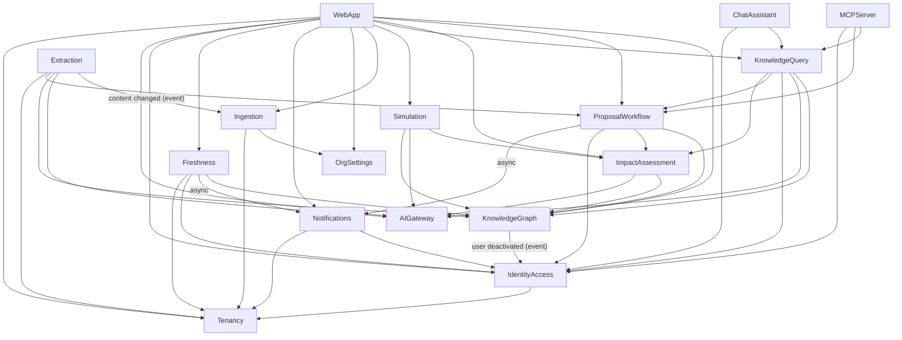

# Component Catalogue: Organisational Context Engine

Inputs: `inception/requirements-analysis/requirements.md` (requirements), `inception/user-stories/stories.md` (stories), `inception/practices-discovery/team-practices.md` (team-practices) and `domain-design-questions.md` (Q1 to Q5). Decisions are recorded in `decisions.md`.

These are the logical building blocks: code we write. Databases, model providers and third-party APIs appear as external dependencies. How components group into deployable units is decided in Units Generation. Technology choices, including where Rust is used, are made in later stages.

**Organisations (added 2026-11-26, Q5; requirements FR14, NFR14).** The hosted service serves many organisations from one copy. The new Tenancy component owns each `Organisation`. Every entity owned by any other component carries an `organisationId` attribute that references `Organisation` (owned by Tenancy); for readability that attribute and reference are stated once here rather than repeated on each entity below. The database enforces the separation with row-level security on `organisationId`, so a query can never return or change another organisation's rows, even if code forgets a filter. A self-hosted install has exactly one Organisation.

## Catalogue

```yaml
components:
  - name: Tenancy
    summary: The organisations on the service, the operators who run it, and the record of their access
    behaviour: >
      Owns each Organisation: its name, its unique address (lower-case letters, digits and hyphens;
      reserved and taken addresses refused), its status (active or suspended) and its hosting region.
      Resolves which organisation a request is for from the address it arrived at. Suspending an
      organisation needs an operator and a reason and is recorded; a suspended organisation's people and
      agents are refused and its background work is skipped, while its data is kept unchanged. Owns operator
      accounts, which sit outside every organisation and sign in to the operator console only. Every time an
      operator opens an organisation's knowledge for support, it records the operator, time, what was opened
      and the reason; these records cannot be edited or deleted and are visible to that organisation's Admins.
      On a self-hosted install there is exactly one organisation, and sign-up and operators are switched off.
    responsibilities:
      - Organisations, their addresses, status and hosting region
      - Resolving the organisation for each request
      - Suspension and reactivation, with recorded reasons
      - Operator accounts and the operator console's data
      - The support access log
    depends_on: []
    dependents:
      - component: IdentityAccess
        interaction: Resolves the organisation from the address; creates an organisation at sign-up; refuses suspended organisations
      - component: Ingestion
        interaction: Skips syncing for suspended organisations
      - component: Extraction
        interaction: Skips extraction for suspended organisations
      - component: Freshness
        interaction: Skips reminders for suspended organisations
      - component: Notifications
        interaction: Skips deliveries for suspended organisations
      - component: WebApp
        interaction: Sign-up, suspended notice, support access log, operator console
    external_dependencies:
      - name: Relational database with row-level security
        kind: database
        purpose: Organisations, operators, support access log; row-level security for every other component's data
    entities:
      - name: Organisation
        identifier: organisationId
        attributes: [name, address, status, hostingRegion, suspendedReason, createdAt]
      - name: OperatorAccount
        identifier: operatorId
        attributes: [email, displayName, status]
      - name: OrganisationStatusChange
        identifier: statusChangeId
        attributes: [organisationId, operatorId, fromStatus, toStatus, reason, changedAt]
      - name: SupportAccessEntry
        identifier: supportAccessId
        attributes: [organisationId, operatorId, subjectRef, reason, openedAt]

  - name: IdentityAccess
    summary: Who people and agents are within an organisation, and what their role lets them do
    behaviour: >
      Signs people in through an established authentication library or service (Google and Microsoft
      single sign-on, email and password); never stores passwords itself. Sign-in happens at the
      organisation's own address, and an account belongs to exactly one organisation: the same email may
      have separate accounts in different organisations. On the hosted service, sign-up creates the
      organisation through Tenancy and makes the person its first Admin. Holds the four roles (Reader,
      Contributor, Approver, Admin) within the organisation and answers permission checks for every other
      component, refusing any request for a suspended organisation. Each Slack or Teams workspace is linked
      to exactly one organisation; a workspace already linked elsewhere is refused. Chat users are matched to
      accounts by work email within that organisation; unmatched chat users get no access. Deactivating a
      person publishes a "user deactivated" event. Service accounts give AI agents a role in one organisation.
    responsibilities:
      - Sign-in, sign-up and sessions (delegated to an established auth library)
      - Users, service accounts and roles within an organisation
      - Permission checks for every read and write
      - Linking chat workspaces to one organisation; chat identity matching by work email
      - Publishing user-deactivated events
    depends_on:
      - component: Tenancy
        interaction: Resolve the organisation from the address; create an organisation at sign-up; check suspension
        style: sync
    dependents:
      - component: KnowledgeGraph
        interaction: Listens for user-deactivated events to unown items
      - component: Notifications
        interaction: Reads people, chat links and email addresses for delivery
      - component: ProposalWorkflow
        interaction: Checks roles for proposing and deciding; finds Approvers
      - component: Freshness
        interaction: Finds Approvers and Admins for unowned stale items
      - component: KnowledgeQuery
        interaction: Checks the asker's role before answering
      - component: MCPServer
        interaction: Authenticates agent service accounts
      - component: ChatAssistant
        interaction: Matches a chat user to an account and role
      - component: WebApp
        interaction: Sign-in, people and role management screens
    external_dependencies:
      - name: Established authentication library or identity service
        kind: third-party-api
        purpose: Single sign-on and email/password sign-in without custom auth
      - name: Google Workspace and Microsoft Entra identity
        kind: third-party-api
        purpose: Work-account single sign-on
      - name: Relational database
        kind: database
        purpose: Users, roles, chat links
    entities:
      - name: User
        identifier: userId
        attributes: [email, displayName, role, status, authProvider]
      - name: ServiceAccount
        identifier: serviceAccountId
        attributes: [name, role, tokenRef, status]
      - name: ChatIdentityLink
        identifier: chatIdentityLinkId
        attributes: [platform, externalUserId, email, userId]
        references:
          - entity: User
            owned_by: IdentityAccess
            relationship: each chat identity links to at most one User
      - name: ChatWorkspaceLink
        identifier: chatWorkspaceLinkId
        attributes: [platform, externalWorkspaceId, linkedAt]
        references:
          - entity: Organisation
            owned_by: Tenancy
            relationship: each Slack or Teams workspace belongs to exactly one Organisation

  - name: OrgSettings
    summary: Organisation-wide settings chosen by Admins
    behaviour: >
      Holds one organisation's privacy-law and security-classification presets, sensitive-content handling
      (default: keep raw content, visible only to Admins), the default review period, and branding. Refuses a brand colour that
      fails contrast in either theme. Every change is recorded with who made it and when.
    responsibilities:
      - Privacy and security presets
      - Sensitive-content policy
      - Default review period
      - Branding (logo, primary colour)
    depends_on: []
    dependents:
      - component: Ingestion
        interaction: Reads the sensitive-content policy and retention rules
      - component: WebApp
        interaction: Settings screens and branding
    external_dependencies:
      - name: Relational database
        kind: database
        purpose: Settings and their change history
    entities:
      - name: OrganisationSettings
        identifier: settingsId
        attributes: [privacyPresets, securityClassifications, sensitiveContentPolicy, defaultReviewPeriodDays, logoRef, primaryColour, updatedBy, updatedAt]

  - name: AIGateway
    summary: One way to reach whichever AI model the organisation chose
    behaviour: >
      Sends prompts to a hosted provider or a self-run endpoint, chosen by the Admin. Stores provider keys
      as secrets and never returns them. Validates model output against the expected structure and reports
      failures instead of passing bad output on. When the model is unavailable it returns an explicit
      "unavailable" result so callers can degrade.
    responsibilities:
      - Model configuration and connection test
      - Calling the chosen model (hosted or self-run)
      - Validating structured output; signalling unavailability
    depends_on: []
    dependents:
      - component: ImpactAssessment
        interaction: Contradiction detection
      - component: Extraction
        interaction: Turning content into proposed items and links
      - component: KnowledgeQuery
        interaction: Answers, life summaries, conversational drafting
      - component: Simulation
        interaction: Running scenarios
      - component: WebApp
        interaction: Model settings and connection test
    external_dependencies:
      - name: Hosted model provider (for example Anthropic Claude)
        kind: third-party-api
        purpose: Hosted AI option
      - name: Self-run model endpoint
        kind: other
        purpose: Organisation-run AI option
      - name: Secret store
        kind: other
        purpose: Provider keys
    entities:
      - name: ModelConfig
        identifier: modelConfigId
        attributes: [mode, provider, endpoint, secretRef, lastTestedAt, lastTestResult]

  - name: KnowledgeGraph
    summary: The organisation's knowledge, its links and its full version history
    behaviour: >
      Stores every item as a single Item with a type (business rule or policy, process, glossary term,
      person, team, system, decision) plus type-specific fields. Every approved change creates a new,
      unchangeable ItemVersion, like a Git commit; the current item is its latest version. Nothing in
      history can be edited or deleted. Items are archived, never deleted. Links between items are typed
      and versioned with the change that added or removed them. Only ProposalWorkflow may write approved
      changes. When a user is deactivated, their items become unowned.
    responsibilities:
      - Items, versions and links
      - Append-only history
      - Ownership and review-period data on items
      - Graph traversal for linked items
    depends_on:
      - component: IdentityAccess
        interaction: Receives user-deactivated events to unown that user's items
        style: event
    dependents:
      - component: ImpactAssessment
        interaction: Traverses links to find affected items
      - component: ProposalWorkflow
        interaction: Reads owners and base versions; applies approved changes
      - component: Freshness
        interaction: Finds items past their review period; records confirmations
      - component: Extraction
        interaction: Finds existing items and candidate links
      - component: KnowledgeQuery
        interaction: Searches and reads approved knowledge
      - component: Simulation
        interaction: Reads the base version for a sandbox
      - component: WebApp
        interaction: Map, list, item and history screens
    external_dependencies:
      - name: Relational database with full-text and vector search
        kind: database
        purpose: Items, versions, links, search index
    entities:
      - name: Item
        identifier: itemId
        attributes: [type, currentVersionId, ownerId, reviewPeriodDays, lastReviewedAt, lastReviewedBy, status]
        references:
          - entity: User
            owned_by: IdentityAccess
            relationship: each Item has zero or one owner User
      - name: ItemVersion
        identifier: versionId
        attributes: [itemId, versionNumber, title, content, why, typeFields, sourceRefs, proposalId, approvedBy, approvedAt, flags]
        references:
          - entity: Proposal
            owned_by: ProposalWorkflow
            relationship: each ItemVersion was created by one approved Proposal
          - entity: SourceDocument
            owned_by: Ingestion
            relationship: an ItemVersion may cite many SourceDocuments
      - name: Link
        identifier: linkId
        attributes: [fromItemId, toItemId, linkType, addedInVersionId, removedInVersionId]

  - name: ImpactAssessment
    summary: Risk and blast radius of any proposed or hypothetical change
    behaviour: >
      Given a change (proposal, draft or sandbox), lists the directly linked items and the items one further
      link away, flags approved items the change appears to contradict, and gives a risk level (Low, Medium,
      High) with reasons based at least on the item type, the number of affected items and any contradiction.
      A contradiction sets the risk to at least Medium. If the AI model is unavailable it still lists linked
      items and marks contradiction checking as unavailable.
    responsibilities:
      - Blast radius (direct and one link further)
      - Contradiction detection
      - Risk level and reasons
    depends_on:
      - component: KnowledgeGraph
        interaction: Traverse links from the changed items
        style: sync
      - component: AIGateway
        interaction: Compare the change with related approved items for contradictions
        style: sync
    dependents:
      - component: ProposalWorkflow
        interaction: Assess every proposal before decision
      - component: KnowledgeQuery
        interaction: Show impact in conversational changes
      - component: Simulation
        interaction: Assess sandbox changes
      - component: WebApp
        interaction: Live impact preview in the editor
    external_dependencies: []
    entities:
      - name: Assessment
        identifier: assessmentId
        attributes: [subjectKind, subjectId, riskLevel, reasons, directlyAffected, oneLinkFurther, contradictions, status, assessedAt]

  - name: Notifications
    summary: Tells people what needs them, through the channels they chose
    behaviour: >
      Creates notifications (proposal waiting, decision on my proposal, override on my item, stale item,
      reassigned items, gap requests) and delivers each through the web app plus the person's chosen chat
      and email channels. Chat delivery needs a linked chat identity. Failed deliveries are retried a limited
      number of times and never block the action that caused them.
    responsibilities:
      - Notification creation and inbox
      - Per-person channel preferences
      - Delivery to web app, Slack or Teams, and email
    depends_on:
      - component: IdentityAccess
        interaction: Recipient details, chat links and email
        style: sync
      - component: Tenancy
        interaction: Skip deliveries for suspended organisations
        style: sync
    dependents:
      - component: ProposalWorkflow
        interaction: Notify owners, proposers and overridden owners
      - component: Freshness
        interaction: Stale-item reminders
      - component: WebApp
        interaction: Bell, notification list and preferences
    external_dependencies:
      - name: Slack and Microsoft Teams messaging APIs
        kind: third-party-api
        purpose: Chat delivery
      - name: Email sending service
        kind: third-party-api
        purpose: Email delivery
    entities:
      - name: Notification
        identifier: notificationId
        attributes: [recipientId, kind, subjectRef, createdAt, readAt, deliveries]
        references:
          - entity: User
            owned_by: IdentityAccess
            relationship: each Notification is for one User
      - name: NotificationPreference
        identifier: preferenceId
        attributes: [userId, kind, webApp, chat, email]

  - name: ProposalWorkflow
    summary: Every change goes through a proposal and an accountable decision
    behaviour: >
      Holds drafts and proposals from people (editor or conversation), extraction and AI agents. A proposal
      records its origin, base versions, changes and reason (required). Each affected item's owner must
      approve, whatever their role; Approvers or Admins approve unowned items; any rejection rejects the
      whole proposal. Self-approval is allowed and flagged. Admins may override an owner with a recorded
      reason, and the owner is notified. Request changes returns the proposal to its proposer with a
      comment and clears approvals so far. A proposal whose base changed is marked out of date and needs
      the decider to pick the winning version. Only one decision per owner is accepted; a second
      concurrent decision is refused. Proposers may withdraw undecided proposals. Archive and link removal
      are proposals. Gap requests ("nothing matches") land here for Approvers. On user deactivation,
      proposals waiting for that user move to Approvers.
    responsibilities:
      - Drafts and proposals
      - Approval routing and decisions
      - Self-approval and override flags
      - Out-of-date detection and concurrency control
      - Gap requests
      - Applying approved changes to KnowledgeGraph
    depends_on:
      - component: KnowledgeGraph
        interaction: Read owners and base versions; apply approved changes
        style: sync
      - component: ImpactAssessment
        interaction: Assess each proposal
        style: sync
      - component: IdentityAccess
        interaction: Role checks; find Approvers
        style: sync
      - component: Notifications
        interaction: Notify owners, proposers and overridden owners
        style: async
    dependents:
      - component: Extraction
        interaction: Raise proposals from captured content
      - component: KnowledgeQuery
        interaction: Create drafts from conversations; raise gap requests; read pending status
      - component: MCPServer
        interaction: Agent proposals
      - component: WebApp
        interaction: Editor, reviews inbox, decisions, withdraw
    external_dependencies:
      - name: Relational database
        kind: database
        purpose: Drafts, proposals, decisions
    entities:
      - name: Draft
        identifier: draftId
        attributes: [authorId, itemId, content, links, why, origin, updatedAt, expiresAt]
      - name: Proposal
        identifier: proposalId
        attributes: [kind, origin, proposerId, baseVersionIds, changes, reason, status, assessmentId, requiredApprovers, createdAt]
        references:
          - entity: Item
            owned_by: KnowledgeGraph
            relationship: a Proposal changes one or more Items
          - entity: Assessment
            owned_by: ImpactAssessment
            relationship: each Proposal has its latest Assessment
      - name: Decision
        identifier: decisionId
        attributes: [proposalId, deciderId, outcome, comment, isOverride, isSelfApproval, decidedAt]
      - name: GapRequest
        identifier: gapRequestId
        attributes: [requesterId, question, channel, status, resolvedByProposalId, createdAt]

  - name: Freshness
    summary: Keeps knowledge current by watching review periods
    behaviour: >
      Once a day marks items past their own review period as stale and reminds their owner; unowned stale
      items go to Approvers and Admins. Owners can confirm an item is still correct without editing it,
      which resets its review date and is recorded in history. Produces each owner's list of stale and due items.
    responsibilities:
      - Daily staleness check
      - Reminders
      - "Still correct" confirmations
      - Owner's stale and due list
    depends_on:
      - component: KnowledgeGraph
        interaction: Find stale items; record confirmations
        style: sync
      - component: Notifications
        interaction: Send reminders
        style: async
      - component: IdentityAccess
        interaction: Find Approvers and Admins; check who may confirm
        style: sync
      - component: Tenancy
        interaction: Skip reminders for suspended organisations
        style: sync
    dependents:
      - component: WebApp
        interaction: My items screen and confirmations
    external_dependencies:
      - name: Scheduler
        kind: other
        purpose: Daily run
    entities:
      - name: ReminderLog
        identifier: reminderId
        attributes: [itemId, recipientId, sentAt, reason]

  - name: Ingestion
    summary: Brings content in from connected tools and uploads
    behaviour: >
      Each source (Google Workspace, Microsoft 365, Slack, ChatGPT projects, file upload, and any new
      connection that follows the standard contract) is a connection with its own status, chosen scope
      (folders, channels, meetings) and last-sync time. Each connection and its credentials belong to
      exactly one organisation; a Google or Microsoft tenant or Slack workspace already connected to another
      organisation is refused. Syncing stops while the organisation is suspended. A failing connection never stops the others.
      Content is stored as SourceDocuments; raw content is kept or discarded and its visibility restricted
      according to the organisation's sensitive-content policy. Publishes "content changed" events.
    responsibilities:
      - Connection contract and connection lifecycle
      - Syncing chosen scopes; uploads and export imports
      - Storing source documents under the sensitive-content policy
      - Connection health
    depends_on:
      - component: OrgSettings
        interaction: Read the sensitive-content policy
        style: sync
      - component: Tenancy
        interaction: Skip syncing for suspended organisations
        style: sync
    dependents:
      - component: Extraction
        interaction: Receives "content changed" events
      - component: WebApp
        interaction: Connection settings, uploads, health
    external_dependencies:
      - name: Google Workspace APIs (Drive, Meet)
        kind: third-party-api
        purpose: Documents and transcripts
      - name: Microsoft Graph (SharePoint, OneDrive, Teams)
        kind: third-party-api
        purpose: Documents, chat and transcripts
      - name: Slack API
        kind: third-party-api
        purpose: Channel messages
      - name: ChatGPT export files (or API if available)
        kind: other
        purpose: Project content
      - name: Object store
        kind: object-store
        purpose: Raw files and transcripts
      - name: Queue
        kind: queue
        purpose: Content-changed events
    entities:
      - name: Connection
        identifier: connectionId
        attributes: [kind, status, scopes, credentialRef, lastSyncAt, lastError]
      - name: SourceDocument
        identifier: sourceDocumentId
        attributes: [connectionId, externalId, kind, title, excerptIndex, rawContentRef, contentHash, author, sourceTimestamp, url, visibility]

  - name: Extraction
    summary: Turns new content into proposals within minutes
    behaviour: >
      On each "content changed" event, uses the AI model to find new or changed knowledge, matches it to
      existing items, suggests links, and raises a proposal with the excerpt and a link to the source.
      Never raises a duplicate for content already extracted (by content hash and matching). If the model
      is unavailable, work is queued and retried, never lost. Target: 95% of proposals within 5 minutes.
    responsibilities:
      - Extracting candidate knowledge and links
      - Matching to existing items
      - De-duplication
      - Raising proposals
    depends_on:
      - component: Ingestion
        interaction: Consume "content changed" events and read source documents
        style: event
      - component: AIGateway
        interaction: Extract candidate items and links
        style: sync
      - component: KnowledgeGraph
        interaction: Match against existing items
        style: sync
      - component: ProposalWorkflow
        interaction: Raise proposals
        style: sync
      - component: Tenancy
        interaction: Skip extraction for suspended organisations
        style: sync
    dependents: []
    external_dependencies:
      - name: Queue
        kind: queue
        purpose: Pending and retried extraction work
    entities:
      - name: ExtractionRecord
        identifier: extractionId
        attributes: [sourceDocumentId, contentHash, proposalIds, status, attempts, lastError]
        references:
          - entity: SourceDocument
            owned_by: Ingestion
            relationship: each ExtractionRecord processes one SourceDocument version

  - name: KnowledgeQuery
    summary: One shared, role-checked way to search and ask, for every channel
    behaviour: >
      Searches and answers questions from approved knowledge only, citing items, owners and sources, and
      labelling pending changes and stale items. Checks the asker's role on every request. When nothing
      matches, offers to raise a gap request. In conversations, can describe the impact of a change and,
      on request, create a draft; it never submits a proposal itself. Produces AI life summaries of items.
      Conversation drafts expire after 7 days if not submitted.
    responsibilities:
      - Search and answers with citations
      - Conversations (Ask)
      - Life summaries
      - Gap requests and conversational drafts
    depends_on:
      - component: KnowledgeGraph
        interaction: Search and read approved knowledge
        style: sync
      - component: AIGateway
        interaction: Compose answers, summaries and drafts
        style: sync
      - component: IdentityAccess
        interaction: Check the asker's role
        style: sync
      - component: ProposalWorkflow
        interaction: Pending status; create drafts; raise gap requests
        style: sync
      - component: ImpactAssessment
        interaction: Impact of a described change
        style: sync
    dependents:
      - component: MCPServer
        interaction: Agent search and read
      - component: ChatAssistant
        interaction: Slack and Teams questions
      - component: WebApp
        interaction: Search box, Ask screen, life summaries
    external_dependencies: []
    entities:
      - name: Conversation
        identifier: conversationId
        attributes: [userId, channel, messages, draftId, createdAt, expiresAt]

  - name: Simulation
    summary: Try changes safely before proposing them
    behaviour: >
      Holds a sandbox copy of a hypothetical change, assesses it with ImpactAssessment and runs AI scenarios
      through a process using the sandbox rules. Nothing changes real knowledge; a sandbox can be turned
      into a draft through the web app.
    responsibilities:
      - Sandbox sessions
      - Scenario runs
    depends_on:
      - component: ImpactAssessment
        interaction: Assess the hypothetical change
        style: sync
      - component: AIGateway
        interaction: Run scenarios
        style: sync
      - component: KnowledgeGraph
        interaction: Read the base version
        style: sync
    dependents:
      - component: WebApp
        interaction: Simulate screen
    external_dependencies: []
    entities:
      - name: SandboxSession
        identifier: sandboxId
        attributes: [userId, baseVersionId, hypotheticalChange, assessmentId, scenarios, expiresAt]

  - name: MCPServer
    summary: The door for AI agents
    behaviour: >
      Exposes MCP tools for searching and reading knowledge and for raising proposals. Every call runs under
      a service account and its role; Readers cannot propose. Answers distinguish approved knowledge from
      pending proposals.
    responsibilities:
      - MCP tools for search, read and propose
      - Agent authentication and role enforcement
    depends_on:
      - component: KnowledgeQuery
        interaction: Search and read
        style: sync
      - component: ProposalWorkflow
        interaction: Raise agent proposals
        style: sync
      - component: IdentityAccess
        interaction: Authenticate service accounts
        style: sync
    dependents: []
    external_dependencies: []
    entities: []

  - name: ChatAssistant
    summary: Answers questions inside Slack and Microsoft Teams
    behaviour: >
      Receives questions in Slack and Teams, matches the chat user to an account by work email (no match:
      tells them to get invited and gives no knowledge), and replies with the answer, owner, freshness and
      a link. Offers to raise a gap when nothing matches. Says it cannot answer when the engine is unreachable.
    responsibilities:
      - Slack and Teams bot adapters
      - Formatting answers for chat
    depends_on:
      - component: KnowledgeQuery
        interaction: Answer questions
        style: sync
      - component: IdentityAccess
        interaction: Match chat user to account and role
        style: sync
    dependents: []
    external_dependencies:
      - name: Slack and Microsoft Teams bot APIs
        kind: third-party-api
        purpose: Receive questions and reply
    entities: []

  - name: WebApp
    summary: The browser experience for every persona
    behaviour: >
      Serves the screens in the refined mockups: 3D map with synced side panel and list view, item page,
      history, reviews, editor with @-linking and suggested links, Ask, Simulate, My items, settings,
      notification preferences and first-run setup. Fully responsive (list view as phone home), light and
      dark themes, per-organisation branding, WCAG 2.1 AA. Holds no business rules of its own; every rule
      is enforced by the component behind it.
    responsibilities:
      - All web screens and their states
      - Accessibility and responsive behaviour
    depends_on:
      - component: KnowledgeGraph
        interaction: Map, list, item, history
        style: sync
      - component: ProposalWorkflow
        interaction: Editor, reviews, decisions
        style: sync
      - component: ImpactAssessment
        interaction: Live impact preview
        style: sync
      - component: KnowledgeQuery
        interaction: Search, Ask, life summaries
        style: sync
      - component: Simulation
        interaction: Simulate screen
        style: sync
      - component: Ingestion
        interaction: Connections, uploads, health
        style: sync
      - component: OrgSettings
        interaction: Settings and branding
        style: sync
      - component: Notifications
        interaction: Bell and preferences
        style: sync
      - component: Freshness
        interaction: My items and confirmations
        style: sync
      - component: IdentityAccess
        interaction: Sign-in, people and roles
        style: sync
      - component: AIGateway
        interaction: Model settings and connection test
        style: sync
      - component: Tenancy
        interaction: Sign-up, suspended notice, support access log, operator console
        style: sync
    dependents: []
    external_dependencies: []
    entities: []
```

## Component Diagram



<!-- Text fallback: Arrows point from a component to the component it depends on. Tenancy depends on nothing; IdentityAccess, Ingestion, Extraction, Freshness, Notifications and WebApp depend on it. WebApp depends on almost everything. MCPServer and ChatAssistant are thin adapters over KnowledgeQuery and IdentityAccess (MCPServer also over ProposalWorkflow). KnowledgeQuery uses KnowledgeGraph, AIGateway, IdentityAccess, ProposalWorkflow and ImpactAssessment. Extraction consumes Ingestion events and uses AIGateway, KnowledgeGraph and ProposalWorkflow. ProposalWorkflow uses KnowledgeGraph, ImpactAssessment, IdentityAccess and Notifications. Freshness uses KnowledgeGraph, Notifications and IdentityAccess. ImpactAssessment uses KnowledgeGraph and AIGateway. Notifications uses IdentityAccess. Ingestion uses OrgSettings. KnowledgeGraph listens to IdentityAccess deactivation events. OrgSettings and AIGateway depend on nothing; IdentityAccess depends only on Tenancy. There are no cycles. -->

## Component Summary

| Component | Purpose | Depends On | Dependents | Entities Owned |
|---|---|---|---|---|
| Tenancy | Organisations, operators, suspension, support access log | — | IdentityAccess, Ingestion, Extraction, Freshness, Notifications, WebApp | Organisation, OperatorAccount, OrganisationStatusChange, SupportAccessEntry |
| IdentityAccess | People, agents, roles, permission checks within an organisation | Tenancy | KnowledgeGraph, Notifications, ProposalWorkflow, Freshness, KnowledgeQuery, MCPServer, ChatAssistant, WebApp | User, ServiceAccount, ChatIdentityLink, ChatWorkspaceLink |
| OrgSettings | Organisation-wide settings | — | Ingestion, WebApp | OrganisationSettings |
| AIGateway | Pluggable AI model access | — | ImpactAssessment, Extraction, KnowledgeQuery, Simulation, WebApp | ModelConfig |
| KnowledgeGraph | Items, links, versioned history | IdentityAccess (event) | ImpactAssessment, ProposalWorkflow, Freshness, Extraction, KnowledgeQuery, Simulation, WebApp | Item, ItemVersion, Link |
| ImpactAssessment | Risk, blast radius, contradictions | KnowledgeGraph, AIGateway | ProposalWorkflow, KnowledgeQuery, Simulation, WebApp | Assessment |
| Notifications | Notify via web, chat, email | IdentityAccess, Tenancy | ProposalWorkflow, Freshness, WebApp | Notification, NotificationPreference |
| ProposalWorkflow | Drafts, proposals, accountable decisions | KnowledgeGraph, ImpactAssessment, IdentityAccess, Notifications | Extraction, KnowledgeQuery, MCPServer, WebApp | Draft, Proposal, Decision, GapRequest |
| Freshness | Staleness and reminders | KnowledgeGraph, Notifications, IdentityAccess, Tenancy | WebApp | ReminderLog |
| Ingestion | Connections and source content | OrgSettings, Tenancy | Extraction, WebApp | Connection, SourceDocument |
| Extraction | Content to proposals | Ingestion (event), AIGateway, KnowledgeGraph, ProposalWorkflow, Tenancy | — | ExtractionRecord |
| KnowledgeQuery | Shared search, answers, Ask | KnowledgeGraph, AIGateway, IdentityAccess, ProposalWorkflow, ImpactAssessment | MCPServer, ChatAssistant, WebApp | Conversation |
| Simulation | Sandbox and scenarios | ImpactAssessment, AIGateway, KnowledgeGraph | WebApp | SandboxSession |
| MCPServer | AI agent door | KnowledgeQuery, ProposalWorkflow, IdentityAccess | — | — |
| ChatAssistant | Slack and Teams answers | KnowledgeQuery, IdentityAccess | — | — |
| WebApp | Browser experience | (12 components) | — | — |

## Entity Ownership

| Entity | Owning Component | Identifier | Attributes | References |
|---|---|---|---|---|
| Organisation | Tenancy | organisationId | name, address, status, hostingRegion, suspendedReason, createdAt | — |
| OperatorAccount | Tenancy | operatorId | email, displayName, status | — |
| OrganisationStatusChange | Tenancy | statusChangeId | organisationId, operatorId, fromStatus, toStatus, reason, changedAt | — |
| SupportAccessEntry | Tenancy | supportAccessId | organisationId, operatorId, subjectRef, reason, openedAt | — |
| ChatWorkspaceLink | IdentityAccess | chatWorkspaceLinkId | platform, externalWorkspaceId, linkedAt | Organisation (Tenancy) |
| User | IdentityAccess | userId | email, displayName, role, status, authProvider | — |
| ServiceAccount | IdentityAccess | serviceAccountId | name, role, tokenRef, status | — |
| ChatIdentityLink | IdentityAccess | chatIdentityLinkId | platform, externalUserId, email, userId | User |
| OrganisationSettings | OrgSettings | settingsId | privacyPresets, securityClassifications, sensitiveContentPolicy, defaultReviewPeriodDays, logoRef, primaryColour, updatedBy, updatedAt | — |
| ModelConfig | AIGateway | modelConfigId | mode, provider, endpoint, secretRef, lastTestedAt, lastTestResult | — |
| Item | KnowledgeGraph | itemId | type, currentVersionId, ownerId, reviewPeriodDays, lastReviewedAt, lastReviewedBy, status | User (IdentityAccess) |
| ItemVersion | KnowledgeGraph | versionId | itemId, versionNumber, title, content, why, typeFields, sourceRefs, proposalId, approvedBy, approvedAt, flags | Proposal (ProposalWorkflow), SourceDocument (Ingestion) |
| Link | KnowledgeGraph | linkId | fromItemId, toItemId, linkType, addedInVersionId, removedInVersionId | — |
| Assessment | ImpactAssessment | assessmentId | subjectKind, subjectId, riskLevel, reasons, directlyAffected, oneLinkFurther, contradictions, status, assessedAt | — |
| Notification | Notifications | notificationId | recipientId, kind, subjectRef, createdAt, readAt, deliveries | User (IdentityAccess) |
| NotificationPreference | Notifications | preferenceId | userId, kind, webApp, chat, email | — |
| Draft | ProposalWorkflow | draftId | authorId, itemId, content, links, why, origin, updatedAt, expiresAt | — |
| Proposal | ProposalWorkflow | proposalId | kind, origin, proposerId, baseVersionIds, changes, reason, status, assessmentId, requiredApprovers, createdAt | Item (KnowledgeGraph), Assessment (ImpactAssessment) |
| Decision | ProposalWorkflow | decisionId | proposalId, deciderId, outcome, comment, isOverride, isSelfApproval, decidedAt | — |
| GapRequest | ProposalWorkflow | gapRequestId | requesterId, question, channel, status, resolvedByProposalId, createdAt | — |
| ReminderLog | Freshness | reminderId | itemId, recipientId, sentAt, reason | — |
| Connection | Ingestion | connectionId | kind, status, scopes, credentialRef, lastSyncAt, lastError | — |
| SourceDocument | Ingestion | sourceDocumentId | connectionId, externalId, kind, title, excerptIndex, rawContentRef, contentHash, author, sourceTimestamp, url, visibility | — |
| ExtractionRecord | Extraction | extractionId | sourceDocumentId, contentHash, proposalIds, status, attempts, lastError | SourceDocument (Ingestion) |
| Conversation | KnowledgeQuery | conversationId | userId, channel, messages, draftId, createdAt, expiresAt | — |
| SandboxSession | Simulation | sandboxId | userId, baseVersionId, hypotheticalChange, assessmentId, scenarios, expiresAt | — |

## External Dependencies

| Component | Dependency | Kind | Purpose |
|---|---|---|---|
| Tenancy | Relational database with row-level security | database | Organisations, operators, support log; separation of every organisation's data |
| IdentityAccess | Established authentication library or identity service | third-party-api | Sign-in without custom auth |
| IdentityAccess | Google Workspace and Microsoft Entra identity | third-party-api | Work-account single sign-on |
| IdentityAccess, OrgSettings, KnowledgeGraph, ProposalWorkflow | Relational database (with full-text and vector search for KnowledgeGraph) | database | Persistent data |
| AIGateway | Hosted model provider, or a self-run endpoint | third-party-api / other | AI model |
| AIGateway | Secret store | other | Provider keys |
| Notifications | Slack and Teams messaging APIs; email sending service | third-party-api | Delivery |
| Freshness | Scheduler | other | Daily run |
| Ingestion | Google, Microsoft Graph and Slack APIs; ChatGPT exports | third-party-api / other | Source content |
| Ingestion | Object store | object-store | Raw files and transcripts |
| Ingestion, Extraction | Queue | queue | Content events and retries |
| ChatAssistant | Slack and Teams bot APIs | third-party-api | Questions and replies |

## Rationale

| Component | Why it is a separate building block |
|---|---|
| Tenancy | Distinct lifecycle (organisations join, are suspended, are reactivated) and distinct actors (operators outside every organisation). Keeps identity about people within one organisation (Q5). |
| IdentityAccess | Distinct concern (security). Every other component asks it; it changes when sign-in or roles change. |
| OrgSettings | Distinct data with an Admin-only lifecycle; read rarely, changed rarely. |
| AIGateway | Isolates the pluggable model choice (hosted or self-run) behind one interface, so no other component knows which model is used. |
| KnowledgeGraph | The source of truth. Append-only versioned history (Q1) and one Item model (Q4) need one owner. |
| ImpactAssessment | Shared by four callers (Q2); its rules change at a different rate from the workflow. |
| Notifications | Delivery across three channels with per-person preferences is a distinct concern; keeps workflow logic free of delivery details. |
| ProposalWorkflow | The accountability rules (owners, overrides, self-approval, concurrency, out of date) change together and must be enforced in one place. |
| Freshness | Scheduled behaviour with its own lifecycle; reads the graph but does not own items. |
| Ingestion | Each external tool's quirks, credentials and failures are isolated behind one connection contract, so "any store of data" can be added. |
| Extraction | AI-driven, queue-based work with retries and de-duplication; separate from the raw fetching so a model outage never stops syncing. |
| KnowledgeQuery | One answering brain for every channel (Q3), so answers and role checks are identical everywhere. |
| Simulation | Sandbox state must never touch real knowledge; separating it makes that guarantee structural. |
| MCPServer, ChatAssistant | Thin adapters per channel (Q3); they change when the channel's protocol changes, not when the business rules do. |
| WebApp | User interface with its own release rhythm; holds no business rules. |

**Alternatives Rejected** (detail in `decisions.md`):
- **Audit log beside mutable items (Q1):** history could drift from the current state.
- **A separate model per item type (Q4):** links, approvals and history would have to be rebuilt for each type.
- **Assessment inside proposals only (Q2):** Simulate, Ask and the editor preview would duplicate it.
- **Per-channel answering (Q3):** answers and role checks would differ between channels.
- **Ingestion and extraction as one component:** a model outage would stop syncing, and connections would be harder to add.
- **Organisations inside IdentityAccess (Q5):** operators are not members of any organisation, and suspension and the support log have their own lifecycle; mixing them into identity would blur "who is this person" with "which customer is this".

## Assumptions & Open Questions

- Which components are written in Rust is decided in a later stage. Candidates are KnowledgeGraph traversal and ImpactAssessment, where performance matters most.
- The full search approach (full-text, vector or both) is detailed in functional design.
- How operators sign in, whether support access needs an Admin's consent first, and per-organisation export and deletion are open in the requirements; Tenancy is where they land once decided.
