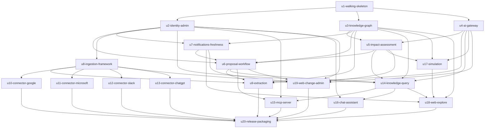

# Unit Dependencies

Inputs: `unit-of-work.md`, `inception/domain-design/components.md` (components; component dependencies), `inception/domain-design/decisions.md` (decisions), `inception/requirements-analysis/requirements.md` (requirements), `inception/user-stories/stories.md` (stories).

This file describes topology only: which unit's code or tests need which other unit's code. It does not set a build order or a critical path; Delivery Planning chooses those.

## Dependency DAG

```yaml
units:
  - name: u1-walking-skeleton
    kind: service
    depends_on: []
  - name: u2-identity-admin
    kind: service
    depends_on: [u1-walking-skeleton]
  - name: u3-knowledge-graph
    kind: service
    depends_on: [u1-walking-skeleton]
  - name: u4-ai-gateway
    kind: library
    depends_on: [u1-walking-skeleton]
  - name: u5-impact-assessment
    kind: library
    depends_on: [u3-knowledge-graph, u4-ai-gateway]
  - name: u6-proposal-workflow
    kind: service
    depends_on: [u2-identity-admin, u3-knowledge-graph, u5-impact-assessment, u7-notifications-freshness]
  - name: u7-notifications-freshness
    kind: service
    depends_on: [u2-identity-admin, u3-knowledge-graph]
  - name: u8-ingestion-framework
    kind: service
    depends_on: [u2-identity-admin]
  - name: u9-extraction
    kind: service
    depends_on: [u3-knowledge-graph, u4-ai-gateway, u6-proposal-workflow, u8-ingestion-framework]
  - name: u10-connector-google
    kind: library
    depends_on: [u8-ingestion-framework]
  - name: u11-connector-microsoft
    kind: library
    depends_on: [u8-ingestion-framework]
  - name: u12-connector-slack
    kind: library
    depends_on: [u8-ingestion-framework]
  - name: u13-connector-chatgpt
    kind: library
    depends_on: [u8-ingestion-framework]
  - name: u14-knowledge-query
    kind: service
    depends_on: [u2-identity-admin, u3-knowledge-graph, u4-ai-gateway, u5-impact-assessment, u6-proposal-workflow]
  - name: u15-mcp-server
    kind: service
    depends_on: [u2-identity-admin, u6-proposal-workflow, u14-knowledge-query]
  - name: u16-chat-assistant
    kind: service
    depends_on: [u2-identity-admin, u14-knowledge-query]
  - name: u17-simulation
    kind: library
    depends_on: [u3-knowledge-graph, u4-ai-gateway, u5-impact-assessment]
  - name: u18-web-explore
    kind: ui
    depends_on: [u3-knowledge-graph, u7-notifications-freshness, u14-knowledge-query, u17-simulation]
  - name: u19-web-change-admin
    kind: ui
    depends_on: [u2-identity-admin, u4-ai-gateway, u5-impact-assessment, u6-proposal-workflow, u7-notifications-freshness, u8-ingestion-framework]
  - name: u20-release-packaging
    kind: packaging
    depends_on: [u9-extraction, u10-connector-google, u11-connector-microsoft, u12-connector-slack, u13-connector-chatgpt, u15-mcp-server, u16-chat-assistant, u18-web-explore, u19-web-change-admin]
```



<!-- Text fallback: Arrows point from a unit to the units that depend on it. U1 comes first; U2, U3 and U4 need only U1. U5 needs U3 and U4. U7 needs U2 and U3. U6 needs U2, U3, U5 and U7. U8 needs U2. U9 needs U3, U4, U6 and U8. The four connectors U10 to U13 each need only U8. U14 needs U2, U3, U4, U5 and U6. U15 needs U2, U6 and U14. U16 needs U2 and U14. U17 needs U3, U4 and U5. U18 needs U3, U7, U14 and U17. U19 needs U2, U4, U5, U6, U7 and U8. U20 needs U9 to U13, U15, U16, U18 and U19. There are no cycles. -->

## Walking skeleton

U1 is the only unit with no dependencies, so it is first in every valid order. It runs on its own: it carries its own thin versions of the item store, proposal approval, MCP read, seeded sign-in and a basic web page, all in containers. Later units deepen those parts without being needed for U1's end-to-end check. (Q5, team Walking Skeleton practice)

## Integration points

| Between | Mechanism | What crosses |
|---|---|---|
| U6 to U3 | In-process call (same `api` container) | Apply an approved change; read owners and base versions |
| U6 to U5, U14 to U5, U17 to U5 | In-process library call | Assess a change |
| U6 to U7, U7 to U2 | In-process call plus async delivery queue | Notifications |
| U2 to U3, U2 to U6 | Event (user deactivated) | Unown items; reroute waiting proposals |
| U8 to U9 | Event queue (content changed) | Source document references |
| U10 to U13 to U8 | Library contract (connection interface) | Source documents |
| U15, U16, U18, U19 to the `api` | HTTP API (MCP protocol for U15) | Queries, proposals, decisions, settings |
| U4 to the model provider | HTTP | Prompts and structured outputs |

Contract Design formalises these boundaries.

## Parallel development opportunities

Units with no path between them can be built at the same time, each in its own copy of the project. (Q4)

- After U1: U2, U3 and U4.
- After U2 and U3: U7 and U8. After U3 and U4: U5.
- After U8: U10, U11, U12 and U13, all independent of each other and of U5, U6 and U7.
- After U5: U17, alongside U6 (once U7 is done).
- After U6: U9 (with U8), U14 and U19 (with U8), independently.
- After U14: U15, U16 and U18 (with U17 and U7).

## Assumptions & Open Questions

- Units built in parallel share the `api` container code base. Each unit keeps to its own module, and the contracts from Contract Design define the interfaces between them.
